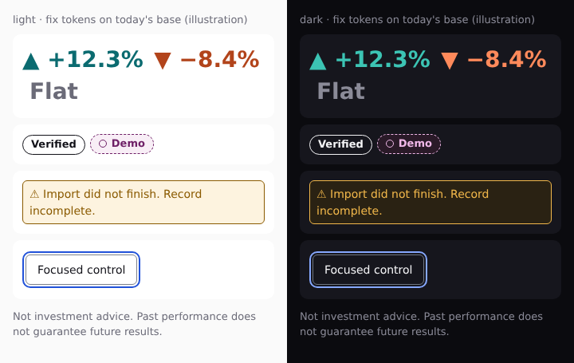

# Stock Social design system: 2026-11-01

Date: 2026-11-01 · Status: **Final: signed by all ten members after five passes; for the approval council** · Council: design system council (ten members, chair, drafting secretary) · Base: `origin/main` e12a834 (#30, #35, #36 merged; open PRs that overlap: #40, #42)

**Summary.** The design system build sessions implement without reopening the debate. It settles the conflicts
between the two direction councils and the idea board (D20 to D29) and changes no owner decision (POLICY, DESIGN
Stage 5, F-1 to F-8). **Fixes ship now on today's base:** light Verified is 3.77:1; light gain/loss are ΔE00 2.8
apart under deutan; display ranges can exclude their headline; the feed hero overflows at 360 px; failed imports
use loss red; `:target` rows fail AA. One `TRUST_LOOK` table (bare "Verified", tuned plum Demo, "New record",
"Public source" for F-7), one `pct()`, the owner's F-4 range wording. **Three variants:** neutral base + ink accent
(V-1), type/spacing/radius collapse (V-2), signed-in nav labels (V-3). Idea-board wording changes are proposals
(DSP-n); owner questions are flags (O-n) with recommendations.

POLICY T1 note: the creative council's palette codename is used nowhere in this document or in code. It is "the
ink palette". Tokens are named by role.

## Settled conflicts

| # | Conflict | Ruling (≤ 20 words) | One-line reason | Where |
|---|---|---|---|---|
| 1 | Badge text: "Verified" vs "Verified from broker" | Bare **"Verified"**: no check glyph, `--verified` outline, links to `/how#verified` | "from broker" reads as broker endorsement (F3a); 76.0 vs 168.1 px at 13 px | §2.1; `SHARE_CARD.verified`; F-4 2026-10-22 |
| 2 | First-visit line (D27 wording) | D27 mechanism kept; wording becomes the positioning line, "Demo records are marked Demo." when needed, D27's link | D27's line calls demo cards verified and hides that Stock Social calculates returns | §2.5; DSP-2 |
| 3 | Demo colour: plum vs sky | **Tuned plum** #6e1f66 / #f0b8e8, dashed border, ring; same box as Verified | The only candidate ≥ 9 ΔE00 from every meaning colour under every simulated deficiency, both bases | §2.2 |
| 4 | "as of" date stamp | "as of" only beside open-position values; records use "Last close · updated"; images print absolute dates with year | "as of" beside a closed return reads as a live valuation | §2.3; F-6 2026-11-01 |
| 5 | Short-record label | TR-7's **"New record"**, on profile and record card only; recommend "Early record" (O-1) | The trigger is < 30 days **or** < 10 trades; "Short record" reads as short selling | §2.4; `lib/trades.ts#isNewRecord` |
| 6 | Positioning line | **"Closed trades imported read-only from connected broker accounts. Losses included."** | States scope and method | §2.5; DSP-2 |
| 7 | Number format | One `pct()`: U+2212, one decimal under 1,000%, two decimals at most, "≈−100.0%" just above −100% | Same advance as "+"; one form per value; each range end printed on its own | §2.6, §3 |
| 8 | Trust language and record context | One `TRUST_LOOK`; feed badge leads the record line; StatusLine on record surfaces; computed image crop band | Three Verified wordings and three Demo names ship today | §2.7, §4 |
| 9 | Tokens: fix vs V-1 | Meaning colours and blue focus ring ship now on today's base; base, accent, on-accent only with V-1 | A value ships as a fix only when a measured defect requires it; the nine names stay | §2.8, §5.1; P4-1; DSP-5 |
| 10 | Hero and tile headroom | Content-fitted figures sized to 78% of their box from the Bold table, tracking counted | F-6's `used ≤ 0.80` then holds; other fonts render wider than pinned DejaVu | §2.8; P4-2 |
| 11 | Range centring | `confidence()` unchanged; display ranges use arithmetic `cardEvidence`; printed lo ≤ avg ≤ hi everywhere | Log-centred ranges can exclude their headline (+25.2% vs −12.5% to +20.6%); ranking must not move | §2.6; DS-13; P4-3 |
| 12 | Type scale and radius | rem steps, clamp only on h1, h2; radius 6/10/999 (999 badges only); collapse = V-2 | The binding constraint is figure width, not the ratio | §5.2; DSP-6 |
| 13 | F-7 public traders | **"Public source"** state: own label, link to each filing, never the Verified look | F-7 owner decision 2026-11-01 | §4.2 |

---

## 1. How the council worked

| Pass | What happened | Output |
|---|---|---|
| 1 | Ten members (product designer, UX lead, data viz, accessibility, content, trust and safety, legal, engineer, common sense, red team) measured contrast (WCAG 2.x), CIEDE2000 after full-severity dichromat simulation (published 2009 matrices) and DejaVu advance widths | Ten position papers |
| 2 | Chair rulings R1 to R8; the chair re-ran the Demo candidates. The secretary drafted this spec. | Draft (pass 2) |
| 3 | Full-council review of the draft: every member "accept with fixes". | §1.1 |
| 4 | Chair rulings P4-1 to P4-13 settled pass-3 disagreements; the secretary revised and re-ran every number. | §1.2 |
| 5 | Sign-off: all ten sign, no dissent; the secretary applied the remaining defects in a final edit | §1.3 |

Precedence: POLICY > owner decisions (F-*.md, DESIGN Stage 5 Musts) > chair rulings (pass 4 over pass 2) >
idea-board decisions D20 to D29 (the approval council can amend their wording) > council proposals.

### 1.1 Pass 3 review

| Member | Verdict | Blocking items → disposition |
|---|---|---|
| Accessibility | accept with fixes | 1 plum numbers vs today's green/rose → fixed (35.4 / 22.6, 34.4 / 29.8, re-run); 2 luminance range → fixed (1.31–1.82 vs ink, up to 2.23 vs today's); 3 `--fs-num-m` in px → fixed (rem, P4-2); 4 tile not a container → fixed (DS-15); 5 StatusLine no-break → fixed (dates only, two rows) |
| Product designer | accept with fixes | 1 base is not a fix → fixed (P4-1, V-1); 2 `--surface-2` hex → fixed (6% mix); 3 feed badge → fixed (P4-8); 4 badge widths at 12 px → fixed (13 px); 5 DS-2 alone → fixed (one PR with DS-3); 6 images → fixed (ink up/down now, base V-1) |
| UX lead | accept with fixes | 1 #41 → fixed; 2 78% → fixed (P4-2, re-run); 3 `f6_wide` → fixed (`--grid-fig-em`, 20.9 px); 4 nav Regular widths → fixed (Bold, 299.7 / 309.1 px); 5 Notice 4 lines, SW-1 → fixed; 6 thesis clamp → fixed at 2 lines (P4-13, not 3); 7 badge right of header → **overruled** (P4-8: record line); 8 screenshot diff → fixed (pin + computed-style tests); 9 counters → fixed (dropped, `ponytail:`); 10 StatusLine → fixed (two rows) |
| Data viz | accept with fixes | 1 decimals → fixed (two in all); 2 average near −100% → fixed differently (P4-7: "≈−100.0%" for any value, not "−99.99%"); 3 chart value size → fixed; 4 axis → fixed ("0%" only); 5 DS-12 recolouring → fixed; 6 #41 → fixed; 7 TR-9 step 2 → fixed (O-16) |
| Content | accept with fixes | 1 share-prompt → fixed (given text); 2 TR-8 broker names → fixed; 3 demo sweep → fixed; 4 completeness / avg sweep → fixed; 5 `lib/claims.ts` → fixed; 6 D24 gaps → fixed, except the `Evidence:` ban, **overruled** (P4-4: TR-9 Must) |
| Trust and safety | accept with fixes | B1 badge → fixed (P4-8, record line rather than the held line); B2 names → fixed (DS-31); B3 `UserNote` → fixed (DS-32); B4 band → fixed (computed layout; the "within 1.5× figure height" test replaced, the computed band puts the record line about 70 px lower); B5 image dates → fixed; B6 definition → fixed (exclusions) |
| Legal | accept with fixes | B1 stale → fixed (rebased); B2 F-7 → fixed (Public source, DS-33); B3 evidence label → fixed (P4-4); B4 too-early triggers → fixed; B5 T1 slip → fixed; B6 font file → fixed (P4-6) |
| Engineer | accept with fixes | B1 #41 → fixed; B2 overlaps → fixed (symbols, copy block at end); B3 ranking → fixed (P4-3); B4 O-5 → fixed (deleted); B5 glyphs → fixed (P4-6); B6 pct → fixed (pins named); B7 DS-2, screenshots → fixed; B8 `color-mix` → fixed (hex `--demo-bg`) |
| Common sense | accept with fixes | 1 headroom → fixed (78%); 2 "F-1" id → fixed (DSP-n); 3 New record on feed → fixed (profile, card only); 4 pane definition → fixed (link) |
| Red team | accept with fixes | B1 same decimals → fixed; B2 average near −100% → **overruled** (P4-7; the "never '−100.0%'" test kept); B3 band → fixed (record line ≥ 40 px, P4-9); B4 trade-image clipping → fixed (DS-19 build gap); B5 frozen on images → fixed; B6 O-4 width → fixed (477 px); B7 `:target` → fixed (fails today too: muted 4.01 / 4.17); B8 tint over bg → fixed differently (P4-10: text on tints over surface only); B9 box widths → fixed (320 / 280) |

Non-blocking items applied where cheap: legal N1–N8; engineer's file corrections; common-sense wording;
content's brokerage, my/your, "result", "skill" and term-drift notes; T&S N1–N6; red-team N1–N3, N5–N9 (N7 as
O-17); accessibility's F94, pressed-state and nav-wrap notes; product designer's radius, variant constraints and
borderless New record; data-viz tint, axis, chart-name and dead-feature notes.

### 1.2 Pass 4 revision

**What changed:** rulings P4-1 to P4-13 applied as listed in §1.1 and marked where used.

**Numbers re-run by the secretary** (Python run isolated; scripts in the scratchpad's `pass4/`):

| Script | What it re-ran |
|---|---|
| `pass4/tokens.py` (shared `a11ylib.py`) | every token pair on both bases; `--surface-2`; Demo and `--demo-bg`; Demo CVD vs every meaning colour; focus with and without offset; tints; `:target`; image colours |
| `pass4/fit.py` | Bold table; hero at 78% with tracking; tile longest fit; nav; badges; StatusLine; Notice; definition; image band; card widths |
| `pass4/budget.py` | card-1 height estimate at 360×740; image band heights |
| `pass1/range.ts` (re-run) | the range-vs-headline reproductions (§2.6) |

**Numbers that differ from a ruling:** the 78% hero at 360 is **41.4–70.4 px**, not "42–72": the box is 320 px
(22cqi caps at 70.4) and "+123,457%" lands at 41.4. Intent kept. The accessibility note "hero ≥ 1.5× root at 200%
text" cannot hold at 78% (36–70 px); recorded as a known limit, not a test.

### 1.3 Pass 5

All ten members signed; nobody recorded a dissent or reopened an owner decision. The secretary applied every
remaining defect in the final edit against `origin/main` e12a834 and re-checked each `app/` and `lib/` reference.

| Member | Verdict | Remaining defects | Disposition |
|---|---|---|---|
| Accessibility | sign | none (StatusLine row 1 is 441.8 px with a 10-letter name, 2 lines either way) | — |
| Common sense | sign | none | — |
| Content | sign | §2.4 vs §4.1 sub-line; "Short record:" lines on month and trade pages; range and "(K of 5 bets)" captions on `HoldTime.tsx`, `Concentration.tsx`, compare; `LAUNCH.connectClosed` "brokerage"; `VERIFIED_DEFINITION` is 72 words | fixed in final edit (§2.4, §4.1, §4.3) |
| Data viz | sign | chart header value had no fit container | fixed in final edit: fixed 1.5rem (§3, §5.2) |
| Engineer | sign | stale base: #30, #35, #36 merged; `.stats[data-long]` moved | fixed in final edit (header, §6 order key and cells "Now", DS-15 by selector) |
| Legal | sign | none | — |
| Product designer | sign | DS-2 tint check fails on today's colours (4.27 / 4.35); feed record line is 3 lines; badge widths | fixed in final edit (DS-2..DS-4 bundled in one PR; §4.3 card 1 rebudgeted to 614 px; §2.1 one width measure) |
| Red team | sign | §5.1 tint and `:target` numbers mislabelled | fixed in final edit (§5.1, §1.1) |
| Trust and safety | sign | none | — |
| UX lead | sign | D1 stale base; D2 "Account" now names F-3's `/account` | fixed in final edit (D1 with the engineer's; D2 in §2.8 and DS-16) |

Final-edit choices: DS-2, DS-3 and DS-4 ship as **one PR** (bundling is simpler than moving checks: the tint,
`--control`, `--surface-2`, `--verified` and `--demo` checks all need DS-4's values). The product designer's 74.8 px
for Verified does not reproduce: the same measure that gives New record 101.8 px gives Verified 76.0 px (§2.1).
The optional red-team check (a tinted element's nearest opaque ancestor is `--surface`) is added to DS-2's
acceptance.

---

## 2. Decisions with reasons and evidence

### 2.1 R1: Badge text is the bare word "Verified"

**Decision.** "Verified", no check glyph; 1 px solid `--verified` (= `--text`), no fill, never the gain colour;
links to `/how#verified`, `plain` (non-link) form inside row links. **Placement (P4-8):** on the feed card it leads
the record line under the figure, never in the name/handle row; elsewhere beside the record stats; never touching
name, handle or avatar. Replaces "✓ Verified from broker" (`lib/copy.ts` `SHARE_CARD.verified`, an F-4 committee
round; the owner's F-4 2026-10-22 names the state "Verified"/"Demo").

| Measure (DejaVu Sans Bold, 13 px, 16 px padding, 2 px border) | "Verified" | "Verified from broker" |
|---|---|---|
| Width | 76.0 px | 168.1 px |
| 200% text | 133.9 px | 318.2 px; > 328 with an icon |
| Literal reading | provenance | "the broker verified this" (F3a) |

One measure for every badge in this spec (Bold text width + 16 px padding + 2 px border, no kerning):
Verified 76.0, Demo 60.1 + ring, New record 101.8, Early record 107.1, Public source 116.1 px.

- Accessible name "Verified: imported read-only from the trader's broker" (2.4.4); the hover-only tooltip goes.
- Today light Verified = `--up` on an 18% tint = **3.77:1** (fails 1.4.3, `app/globals.css:110`); dark is the gain
  colour itself (ΔE00 0). New: `--text` 18.01 / 18.80 light, 17.88 / 16.39 dark (today's base).
- The guard R1 relies on (no "Verified" or check glyph in names) is built in DS-31.

### 2.2 R2: Demo colour is tuned plum

**Decision.** `--demo` **#6e1f66** / **#f0b8e8**; 1 px **dashed** border, ring, the word "Demo"; same size, weight
and box as Verified; never on a figure, chart line or area. Web draws the ring as "○" (`aria-hidden`); images draw a
bordered circle (P4-6). `--demo-bg` #f8eef6 / #2a1a28 (hex literals; the kept `lib/badge-contrast.test.ts` parses
hex only).

Fix tokens are identical on both bases, so Demo's CVD distances hold on today's base and on V-1. Cells: normal ΔE00
/ minimum over protan, deutan, tritan (`chair_demo.py`, `pass4/tokens.py`). < 10 = close at badge size.

| Candidate | Scheme | vs up | vs down | vs focus | vs warn | Verdict |
|---|---|---|---|---|---|---|
| **tuned plum #6e1f66** | light | 38.8 / **9.2** | 37.2 / 18.8 | 26.2 / 16.2 | 48.9 / 14.6 | **adopted** |
| **tuned plum #f0b8e8** | dark | 44.9 / **10.3** | 33.0 / 18.0 | 26.0 / 11.1 | 46.5 / 10.1 | **adopted** |
| plum #8a2b7f / #e79ddd | L / D | 6.1 (deutan) / 9.0 | 14.2 / 13.1 | 12.7 / 6.6 | 10.9 / 9.6 | fails < 10 |
| sky #0369a1 / #38bdf8 | L / D | 5.1 / 4.7 (tritan) | 44.6 / 45.3 | 6.9 / 1.9 (deutan) | 43.6 / 50.1 | rejected |
| violet #6d28d9 / #a78bfa | L / D | 17.7 / 19.5 | 37.2 / 32.2 | **0.3** / 3.2 | 30.2 / 29.4 | rejected (today's accent) |

| Tuned plum, re-run | Light | Dark |
|---|---|---|
| on bg / surface, today's base | 9.81 / 10.24 | 11.91 / 10.91 |
| on bg / surface, V-1 base | 9.46 / 10.24 | 11.46 / 10.46 |
| on `--demo-bg` (both bases) | 9.05 | 9.97 |
| CVD min vs today's violet accent | 16.1 | 16.0 |
| CVD min vs `--text` today / V-1 | 19.2 / 18.3 | 13.3 / 12.1 |
| CVD min vs today's green/rose (before DS-4) | 35.4 / 22.6 | 34.4 / 29.8 |
| Luminance ratio vs ink up/down | 1.63 / 1.82 | 1.31 / 1.41 |

Luminance ratios stay < 3:1 (up to 2.23), so word, dashed border and ring carry Demo. Images: 11.91 on #0b0b0f; CVD
min vs today's card gain/loss 34.4 / 29.8, vs ink 10.3 / 18.0. The product designer now accepts tuned plum.

### 2.3 R3: Dates

| Context | Form | Rule |
|---|---|---|
| Open-position value | "as of ‹Mon D[, YYYY]›" (`lib/copy.ts` `OPEN`) | only beside a valuation, same element (F-6 2026-11-01) |
| Record freshness, web | "Last close ‹date› · updated ‹relative›"; "updated just now" under 1 min | D29; StatusLine row 2; server sends the absolute time, the client formats the relative part (the pane JSON is cached 60 s) |
| Idle (no sync 30 days) | "Last close ‹date› · not updated since ‹Mon D, YYYY›" | D29 |
| Frozen | "Disconnected ‹Mon D, YYYY› · record frozen"; "updated" dropped | TR-5; outranks every freshness date |
| Account removed | "Account removed ‹Mon D, YYYY›" on its rows | TR-5 |
| Trade image | "closed ‹Mon D, YYYY›" beside the link + state line "Last close ‹Mon D, YYYY›" | year always; never relative, never "as of" |
| Month image | the month + "Last close ‹Mon D, YYYY›" | same |
| Stock image | no date | F3b |
| Frozen record on any image | "Disconnected ‹Mon D, YYYY› · record frozen" replaces "Last close" | TR-5 |
| Record card | O-3 (OD-14) | recommend "Last close ‹Mon D, YYYY›" |
| Web year rule | year only when not the current year | one `dateText()`, UTC |

Reasons: "as of" beside a closed return reads as a live valuation; relative time on an image freezes at render; a
trade image keeps its own close date by the link so an old trade never looks current.

### 2.4 R4: Short-record label

| Candidate | 13 px badge | Problem |
|---|---|---|
| "Record under 30 days" | — | false: `lib/trades.ts#isNewRecord` is < 30 days **or** < 10 closed trades |
| "Short record" | — | reads as a record of short sales, which `/how` lists as excluded |
| **"New record"** (TR-7) | 101.8 px | can read as an all-time high; mitigated by placement |
| "Early record" (O-1) | 107.1 px | true under both triggers; matches "Too early to tell" |

**Decision.** "New record" verbatim, **on the profile (TR-7) and the record card image only**; the feed card, pane,
trade and month pages carry the record line, which shows the range or "Too early to tell". Plain `--muted` text, no
border (Verified is the only solid outline, Demo the only dashed one), links to `/how#new-record`. The sub-line "New record · short record, wide uncertainty" is removed from
`lib/month-card.ts:39`, the trade image (`trade/[sellId]/opengraph-image.tsx:59`) and the trade and month pages. On
the profile it becomes "New record · under 30 days or under 10 closed trades".

### 2.5 R5: Positioning line and first-visit line

| Candidate | Finding |
|---|---|
| D27 "Verified trades, straight from the broker. Losses included." (meta today, `app/layout.tsx:11`) | calls demo cards verified (the seed is all demo); "straight from" hides that Stock Social calculates the returns (F3a) |
| Design P-3.7 "Trading records imported read-only from traders' brokers. …" | "traders' brokers" reads as all their brokers (TR-8) |
| **"Closed trades imported read-only from connected broker accounts. Losses included."** | **adopted**: scope and method |

**Decision.** The line is the meta description, `/` image text and `/how` intro (DSP-2; else D27 verbatim).
First-visit Notice (D27 mechanism): the line, "Demo records are marked Demo." while page 1 holds a demo card, then
D27's link "How records are calculated →": 1,043 px, **4 lines** beside the floated 44 px Dismiss, ≈ 105 px. It
shares the SW-1 slot one at a time: the Notice first, the "Swipe ← for profile" hint after dismissal or on card 2.
D25's Stocks line → "Browse stocks that have closed trades on Stock Social." (DSP-3; demo-only stocks are
listed). "Check the record, not the screenshot." stays off every surface until the name is cleared (T5a).

### 2.6 R6: Number format

Table in §3. Evidence:
- **DejaVu Sans Bold advances (em, re-checked):** digit 0.696, "+" 0.838, U+2212 0.838, "-" 0.415, "%" 1.002,
  "." "," 0.380, "≈" 0.838; ▲/▼ 0.769, space 0.348. U+2212 aligns gains and losses.
- **Near −100% (P4-7):** today `pct(-0.99999)` = "-99.999%" and `pct(-0.9999999)` = "-99.99999%" (re-run). New:
  at most two decimals in all; any value strictly between −100% and −99.995% (a trade, an average, a range end)
  prints "≈−100.0%"; exactly −100% prints "−100.0%".
- **Zero:** 15 inline tone decisions; 12 paint 0.0% red, `chart.tsx` paints it green. **Win rate:** 199/200 prints
  "100%" today.
- **BUILD GAP, display range vs headline (P4-3):** `confidence()` centres `perTrade` on the mean of log returns; the
  headline is arithmetic; F-4 2026-10-31 requires the arithmetic centre. Re-run with shipped functions:

| Record | Headline | Shipped range | Inside? | Arithmetic (`cardEvidence`) |
|---|---|---|---|---|
| 1 × +900%, 29 × −5% | +25.2% | −12.5% to +20.6% | **no** | −36.5% to +86.9% |
| 100 × alternating +80% / −40% | +20.0% | −6.9% to +16.0% | **no** | +8.0% to +32.0% |
| 40 × alternating +60% / −30% | +15.0% | −7.4% to +21.0% | yes | +0.4% to +29.6% |
| 6 × +1% | +1.0% | +1.0% to +1.0% | false in floats | +1.0% to +1.0% (O-17) |
| 6 near −100% | −68.8% | −99.0% to −45.7% | yes | −100.0% (clamped) to −7.3% |

Fix: **`confidence()` stays as is** (it feeds `tooWide`, the tier, `evidenceWeight`, `trustSign`, the stock baseline
and ranking). Display surfaces take the arithmetic range through `lib/record-card.ts#cardEvidence` /
`lib/bets.ts#arithmeticRange` (on main since #35; the profile and `lib/display-log.ts` already call `cardEvidence`) (DS-13).

### 2.7 R7: One trust language and record context

- One `TRUST_LOOK` (`lib/trust-look.ts`, §4.2) drives `Badge`, `Notice` and every image renderer. Today three
  Verified wordings and three Demo names ship ("Demo", "Demo data", "Sample data").
- **Failed import never uses `--down`** (today `className="down record-failed"` in `app/ui.tsx`, profile and month
  page). Warn vs down CVD min is 3.2 light / 6.4 dark (deutan), so warn always has icon, box and words.
- **Feed card:** badge + D22's one record line; no 7-part strip. **Pane:** StatusLine ending "What Verified means
  →", headline + range, in-view disclaimer. **Profile, trade, month, `/t`:** StatusLine + `VERIFIED_DEFINITION` +
  in-view disclaimer (D20). **Images:** the computed crop band (§4.3).
- **Evidence label stays (P4-4; TR-9 Display Must, F-4 2026-10-22):** "Evidence: ‹tier› (‹K› bets, ‹D› days)" beside
  the F-4 trust line. Today's string from `lib/trades.ts#evidenceLine`: "Past results: above zero · Evidence: thin
  (12 bets, 60 days)" (edge clause "above zero" / "below zero" / "unclear"). The edge clause is owner flag O-15.
- **"Too early to tell"** replaces the range when K < 5 **or** the half-width exceeds 10 points per trade (F-4
  2026-10-22, TR-9).
- **User text never passes as platform text (P4-11):** every thesis renders in one `UserNote` with an attribution
  label (DS-32); platform lines use `--fs-small` / `--muted` and user text never does.

### 2.8 R8: Tokens

Full table in §5. **Rule (P4-1):** a value ships as a fix only when a measured AA, CVD or fit defect requires that
value.
- **Fixes on today's base:** meaning colours (§5.1 "fix" rows; light deutan gain/loss ΔE00 2.8 → 27.8). **V-1:**
  bg, surface, text, muted, line, accent, on-accent; today's base has no defect (muted 5.03 / 5.25, 5.84 / 5.35).
- **Focus ring = fix:** blue #2152d9 / #86a8ff with a mandatory 2 px offset is 6.15 / 6.42 light and 8.47 / 7.76
  dark against today's bg/surface. Without the offset it is 1.11 / 1.17 against a violet button (2.79 / 1.99 against
  an ink one), so the offset is required. Under deutan the ring and the violet fill look alike (ΔE00 0.3); the 2 px
  gap of page colour separates them.
- Keep the nine variable names (about 55 rules merged with #30 and #36 read them). 13 px text floor. Links stay
  underlined (no accent reaches 3:1 against body text; WCAG F73).
- **Content-fitted figures (P4-2):** sized to **78%** of their box from the Bold table with tracking counted, so
  F-6's `used ≤ 0.80` (`e2e/f6-open-positions.spec.ts`) holds; `align-items: safe center` on the hero; DejaVu is
  pinned in e2e (#41, merged).

**Hero:** `font-size: min(120px, 22cqi, calc(78cqi / var(--fig-em)))`; `--fig-em` = `figureEms(s, −0.04)` server-
side (advances − 0.04 per character). Box = card content: 320 px at 360, 280 at 320 (`padding: max(20px, …)`).

| Figure | em / tracked | 320 px box (360) | 280 px box (320) | 520 px box | used |
|---|---|---|---|---|---|
| "+12.3%" | 4.308 / 4.068 | 61.4 px | 53.7 | 99.7 | 0.780 |
| "−4.5%", "+0.4%" | 3.612 / 3.412 | 70.4 (22cqi cap) | 61.6 | 114.4 | 0.751 |
| "−100.0%", "+999.9%", "+1,235%" | 5.004 / 4.724 | 52.8 | 46.2 | 85.9 | 0.780 |
| "≈−100.0%" | 5.842 / 5.522 | 45.2 | 39.6 | 73.5 | 0.780 |
| "+12,346%" | 5.700 / 5.380 | 46.4 | 40.6 | 75.4 | 0.780 |
| "+123,457%" | 6.396 / 6.036 | 41.4 | 36.2 | 67.2 | 0.780 |

Today at 360 `clamp(64px, 22vw, 120px)` = 79 px: "−100.0%" 396 px against 320. A visible "Flat" goes on its own
line, so it is not counted. DejaVu has no 800; the weight renders as Bold, which the table measures.

**Stat tiles:** `.stats > *` `container-type: inline-size`; figure `min(var(--fs-num-m), calc(78cqi /
var(--grid-fig-em)))`, `--grid-fig-em` = the widest printed value in the grid (▲/▼ at 0.6 em + space count), one
size per grid (F-6 D5). 2-column tile content box at 360 = 134 px: **longest at full 24 px = 4.355 em** ("+12.3%",
"−40.0%" fit); longer values step down, never clip: "+123.4%" / "+6,123%" 20.9 px, "▼ −40.0%" 20.4, "+12,346%"
18.3, "≈−100.0%" 17.9, "+123,457%" 16.3. Full-width tile (302 px) at `--fs-num-l` 32 px fits 7.36 em. Today's 24 px
overflows by 3 px ("+12,346%") and 6 px ("≈−100.0%").

**Nav (links weight 600 → Bold; 14.4 px at ≤ 420 px; gap 10; 328 px):** today signed out 327.9 px (0.1 spare);
signed in with a 20-character handle about 382 px with ellipsis (overflows). New signed out "Stock Social · Trades
by stock · Sign in" **299.7 px**; signed in **"Stock Social · Trades by stock · Account" 309.1 px** ("Account" links to
`/account`, F-3's page from #36, which gains "Your profile (@handle)" and "My record" links; DS-16). "Trades by stock · My record" fits only without the handle (325.1 px, 2.9 spare), so
"My record" leaves the nav (V-3 varies the label under the same test).

---

## 3. Number format

All formatting lives in `lib/format.ts`: `pct()` (moved from `lib/trades.ts#pct` and re-exported there), `imagePct()`,
`winPct()`, `tone()`, `figureEms()`, `rangeLine()`, `dateText()`, `imageDate()`, `count()` / `counted()` (exist).

| Case | Format | Example | Where |
|---|---|---|---|
| Gain | "+", one decimal | +12.3% | everywhere |
| Loss | U+2212, one decimal | −12.3% | everywhere, alt text, metadata |
| Prints as zero | no sign, `--flat`, visible "Flat" (own line on the hero); "about even" in accessible text | 0.0% Flat | rows, tiles, hero |
| ≥ 1,000% (rounded absolute) | whole number, thousands comma; per number | +1,235% (losses stop at −100.0%) | everywhere |
| Near-total loss | at most two decimals in all | −99.95% · −99.99% | `pct()` |
| Strictly between −100% and −99.995% | "≈−100.0%" (any value: trade, average, range end, chart header) | ≈−100.0% | `pct()`; images print "about −100.0%" (`imagePct()`) |
| Total loss | exact | −100.0% | everywhere; range low clamp is exact |
| Average with range | "‹avg› per trade, likely between ‹lo› and ‹hi›"; each number through `pct()` on its own | +666.7% per trade, likely between −100.0% and +2,381% | profile, pane, card, `/t`, compare, month, trade |
| Too early | K < 5 or half-width > 10 points: "Too early to tell" replaces the range | Too early to tell (3 of 5 bets) | record line, profile |
| Evidence label | "Evidence: ‹tier› (‹K› bets, ‹D› days)" beside the trust line | Evidence: thin (12 bets, 60 days) | profile, card (TR-9, F-4) |
| Win rate | whole percent; never 100% with a loss, never 0% with a win | 99% win rate | beside average and range only (F-4) |
| Counts | grouped, unit named via `counted()`, never "(s)" | 2,828 closed trades · 1 account | everywhere |
| Chart axis | "0%" only | 0% | `chart.tsx`, images |
| Chart header value | fixed 1.5rem, no fit rule (widest 6.396 em = 153.5 px in 328 px); tone of the printed end value | +47.2% | pane, profile |
| Unrealized | then "as of ‹date›" in the same element | −3.1% as of Nov 1 | F-6 surfaces |
| Rates | "~" only on rates (TR-9) | ~15 trades/month | TR-9 |
| Marks | ▲/▼ at 0.6 em on rows and tiles; never on the hero | ▼ −4.5% | web lists |

Invariants (tests):
- Parsed printed lo ≤ avg ≤ hi on every surface (`pct()` is monotonic; "≈−100.0%" parses as just above −100).
- Every negative string starts with U+2212 or "≈U+2212"; "≈" appears only directly before "−100.0%".
- An average of six trades at −99.996% prints "≈−100.0%", never "−100.0%".
- No "≈" outside `pct()`; no `> 0 ? 'up' : 'down'` or `>= 0 ?` tone decisions in `app/` (grep).
- Images: a renderer cmap test asserts U+2212 in the renderer's built-in font and fails the build if missing; only
  then images fall back to the hyphen-minus, alt text keeps "a loss", and the owner is told (O-18).

---

## 4. Trust language

### 4.1 String table

New copy constants go in one block at the end of `lib/copy.ts` (open PRs #40 and #42 edit it).
Rows marked (DSP-n) are proposals: if rejected, the governing decision's own wording ships.

| Key | Current | Final | Gov. |
|---|---|---|---|
| `Badge` verified | "✓ Verified" + tooltip (`app/ui.tsx`) | "Verified"; link `/how#verified`; `plain` inside row links | R1, F3a |
| `Badge` demo | "Demo" + tooltip "Sample data, not from a real broker."; hand-rolled spans (month, trade pages) | "Demo" + ring, link `/how#demo` | R2, P2 |
| `SHARE_CARD.verified` / `.connected` / `.demo` | "✓ Verified from broker" / "✓ Broker connected" / "Demo data" | "Verified" / "Broker connected" / "Demo" | R1, R2 |
| `SHARE_CARD.demoImage` | "Demo data, not a real broker record" | unchanged; also on Demo trade and month images | R7 |
| `STORY_VERIFIED` | "Imported read-only from the broker" | pill "Verified" + "Imported read-only from the trader's broker" | R1 |
| stock image status | "Sample data" / "Includes sample data" / "Verified from broker" (`app/t/[symbol]/opengraph-image.tsx`) | "Demo data" / "Includes demo records" / no Verified pill for a security | R2, F3b |
| all "sample data" (`/sample data/i`) | `app/pane.tsx:46`; `app/t/[symbol]/page.tsx` (description, 138, 139, 193, 200); `app/t/page.tsx` aria; `Theses.tsx`, `Concentration.tsx`, `Spread.tsx`, `Timeline.tsx`, `HoldTime.tsx`; `Baseline.tsx` ("Sample data. No comparison verdict is drawn from sample data."); `lib/ticker.ts` (328, 329, 338) | "demo records" where counted or included ("Includes demo records, marked Demo."); "Demo data, not from a real broker." as the definition | R2 |
| `/t/[symbol]` description | "… verified closed trades … Sample data." | "‹N› closed trades in ‹SYM› on Stock Social, losses included." + "Includes demo records." when mixed | F3b |
| new `VERIFIED_DEFINITION` | two paraphrases (`app/layout.tsx`, `HOW.verified`) | "Imported read-only from the trader's broker. Returns are calculated by Stock Social from those trades. Options are skipped. Sells with no recorded entry, including short sales and shares transferred in, are left out and counted on the profile. Verified does not confirm who the trader is, does not show accounts at other brokers, and is not a measure of skill, an audit or an endorsement by the broker, SnapTrade or anyone else." (links `/how#excluded`) | R1, P4-8, F3a |
| new `PANE.verifiedLink` | none | "What Verified means →" (`/how#verified`) | P4-8 |
| `DISCLAIMER` (footer) | literal in `app/layout.tsx` | `DISCLAIMER` from `lib/share.ts` | F3, D20 |
| `metadata.description` | D27 line | positioning line; + "Demo records are marked Demo." while demo users exist (DSP-2) | R5 |
| new `FIRST_VISIT.line` / `.demo` / `.link` / `.dismiss` | none | positioning line (DSP-2) / "Demo records are marked Demo." (demo card on page 1) / "How records are calculated →" (= `FOOTER.how`) / "Dismiss" (aria "Dismiss this note") | R5, D27 |
| nav | "Stocks"; "Publish your trades"; "My record" + "@handle" | "Trades by stock"; "Sign in"; signed in "Account" | D21, D27, V-3 |
| `/t` title / description / intro | "Stocks with verified trades …" / "Browse every stock …" / "…verified closed trade…" | "Trades by stock · Stock Social" / "Browse stocks that have closed trades on Stock Social." (DSP-3) / "Stocks with at least one closed trade from connected accounts or demo records. Open a stock to see its trades, losses included. Percentages only." | D25, F3a |
| `/t` aria (`app/t/page.tsx:128`) | "Stocks with verified trades" | "Trades by stock" | F3a |
| `SIGNIN.title`, publish/follow paths | "Publish your trades" | "Sign in"; "Publish my record" / "Follow and save records" | D21 |
| `FEED.publish`, `join-cta.tsx:10` | "Publish your trades" / "Verify your record" | "Publish my record" (buttons acting on the viewer's data say "my"; headings and links say "your") | D21 |
| `TRUST_NOTICE.primary`, `PORTAL.title` | "Connect brokerage (read-only)" | "Connect my broker (read-only)" / "Connect your broker" | glossary |
| "brokerage" sweep | `SIGNIN.brokerage`, `PROFILE.youreIn`, `RESULT.*`, `PORTAL.title`, `HOW.freeze`, `SETTINGS.deleteExplain`, `LAUNCH.connectClosed` | "broker" (`SIGNIN.brokerage` likely goes under D21); `LAUNCH.connectClosed` "Connecting a broker isn't open yet." | glossary |
| `lib/claims.ts:7` | "This is what keeps every record verified." | "This keeps each broker account on one record." | F3a |
| StatusLine row 1, real | "Record since ‹date› · ‹connected›. Only trades from connected accounts are shown." | "Record since ‹Mon D, YYYY› · Connected: ‹broker names› (‹N accounts›)" via `connectedLine` + `counted()` | TR-8 |
| StatusLine row 2 | none | "Last close ‹date› · updated ‹relative›" / "· not updated since ‹date›" | D29 |
| StatusLine, demo / frozen | same as real / "Connected: …" after disconnect | "Record since ‹date› · Demo" / row 1 "Disconnected ‹Mon D, YYYY› · record frozen", row 2 "Last close ‹date›" | P2, TR-5 |
| `STATUS.accountRemoved` / `.account` | none / "account N" | "Account removed ‹Mon D, YYYY›" / "Account N of M" | TR-5, D29 |
| `.badge.new` | "New record" (profile, card, month, trade pages) | profile and record card only; link `/how#new-record` | TR-7, R4 |
| New-record sub-line | "New record · short record, wide uncertainty" (`lib/month-card.ts:39`, `trade/[sellId]/opengraph-image.tsx:59`) | removed there and on trade and month pages; profile only: "New record · under 30 days or under 10 closed trades" | R4 |
| "Short record:" lines | "Short record: ‹N› so far. A short record shows wide uncertainty." (`month/[ym]/page.tsx:82`, `trade/[sellId]/page.tsx:64`) | removed; the record line shows the range or "Too early to tell" | R4 |
| `share-prompt.tsx:46` | "A short record means wide uncertainty. …" | "A new record has a wide range. You have ‹N closed trades› so far, and the card is labelled New record. Right now the range is ‹range›." | TR-7 |
| new `HOW.newRecord` | none | "New record: under 30 days of history or under 10 closed trades. A new record has a wide range." | D24 |
| incomplete badge | `.badge.new` reused (`app/suggest-section.tsx`) | `TRUST_LOOK.incomplete` (warn) | R7 |
| evidence line | "Past results: ‹edge› · Evidence: ‹tier› (…)" (`evidenceLine`) | "Evidence: ‹tier› (‹K› bets, ‹D› days)" beside the F-4 trust line; edge clause per O-15 | P4-4 |
| too-early, grouped (`evidenceLine`, `confidence`) | "Too early to tell: N trades in K overlapping positions (5 independent bets needed)"; "(‹K› bets from ‹N› trades)" | "Too early to tell: the range is still wide. ‹N› trades, counted as ‹K› separate bets because some overlapped." | D24 |
| profile preview (`statsText`, `app/u/[handle]/page.tsx`) | "Evidence: too early" | "Too early to tell" | D24 |
| `Baseline.tsx:39` | "Not enough independent bets…" | "Not enough bets…" | D24 |
| range caption / note | "‹lo› to ‹hi› · 95% range"; "95% range from independent bets (…)"; `rangeText` "(‹lo› to ‹hi›)"; "· 95% range" (`[symbol]/page.tsx:144`, `[symbol]/HoldTime.tsx:29`, `[symbol]/Concentration.tsx:28`, `t/compare/page.tsx:78`); "95% range" (`[symbol]/opengraph-image.tsx:68`) | `rangeLine()` "likely between ‹lo› and ‹hi›"; note "Range from bets: same-stock trades that overlap count as one bet. A wider range means less evidence." ("95%" on `/how` only) | F-4, D24 |
| too-early caption | "Too early to tell (‹K› of 5 bets)" (`[symbol]/page.tsx:144,163`, `HoldTime.tsx:29`, `Concentration.tsx:28`, `t/compare/page.tsx:78`) | unchanged (§3 example) | F-4, TR-9 |
| avg label | "avg return / trade", "avg return" (pane headline stat, profile `statsText` and headline stat, month `:64,:80`, trade `:62`, `[symbol]/page.tsx:143`, compare `:77`, `[symbol]/opengraph-image.tsx:61`, `lib/ticker.ts:334`); "avg ‹pct›" (`lib/month-card.ts`) | "average per trade" (F-6's owner-decided "avg / result" exempt by name) | D24, F-4 |
| profit factor | "profit factor" | "Profit factor"; What's this: "Total gains divided by total losses, in percent per trade." | D24 |
| completeness | "Their whole record", "whole record:", "@h's full record", "Whole record:" (month page, `lib/month-card.ts`); "full record" (`trade/[sellId]/page.tsx:44`); alt "…, with the whole record" / "…, with the full record" | "Their record", "record:", "@h's record", "Record:"; alt "…, with the trader's record line" + both disclaimer sentences | F3a |
| empty feed | dev command | "No public records yet." + (only when connect is on, D26) "Connect your broker to publish the first record." | D25 |
| `FEED.retry` / `SECTION.skip` | "Retry" / "Skip to the disclaimer" | "Try again" / "Skip to disclaimer and legal links" | glossary |

Exempt by name (owner wording, F-1): `TRUST_NOTICE` "full trade history" and `CONSENT` "every account".

**Banned in UI copy** (string test, case-insensitive): "Verified from broker", "straight from", "sample data",
"independent bets", "overlapping position", "95% range" (outside `/how`), "every stock", "whole record", "full
record", "Record under 30 days", "short record", "brokerage", "Retry", "Verify your record", any check glyph
(U+2611, U+2705, U+2713, U+2714, U+1F5F8).

**Glossary:** record · closed trade · open position · result (closed trade or open position; F-6 only) · bet ·
broker · SnapTrade (the only vendor name) · Verified · Demo · Public source · average per trade · likely between ‹lo›
and ‹hi› · Too early to tell · Last close ‹date› · updated ‹relative› · Disconnected ‹date› · record frozen ·
Account removed ‹date› · Account N of M · as of ‹date› (valuations only) · New record · Publish my record · Follow
and save records · Sign in · Try again · Trades by stock · Held ‹N› days · the trader's broker.

### 4.2 TRUST_LOOK

One table in `lib/trust-look.ts`. `Badge`, `Notice`, `lib/record-card.ts`, `lib/month-card.ts`, `lib/story-image*`
and every image file read it; image colours from `lib/palette.ts` (DS-6).

| State | Word | Colour | Border | Glyph | Link | Notes |
|---|---|---|---|---|---|---|
| Verified | "Verified" | `--verified` | 1 px solid, no fill | none | `/how#verified` | every activity `source='snaptrade'`; the only solid outline |
| Demo | "Demo" | `--demo` on `--demo-bg` | 1 px dashed | ring: "○" on web (`aria-hidden`), bordered circle on images | `/how#demo` | same box and weight as Verified; images add "Demo data, not a real broker record" |
| Public source (F-7) | working word "Public source"; final word set by F-7's committee, never "Verified" | `--muted` | 1 px solid `--control` | none | a link to each public filing; `/how#public` | never the Verified look or `VERIFIED_DEFINITION`; StatusLine names the source; 116.1 px |
| Importing | "Importing record" | `--muted` | none | static "…" | `/how#verified` | stats hidden |
| Broker connected (no closes) | "Broker connected" | `--muted` | none | none | none | no check glyph |
| Record incomplete / failed import | "Import did not finish" | `--warn` on `--warn-bg` box | 1 px solid `--warn` | warning triangle, SVG, `aria-hidden` | `/how#incomplete` | `role="status"`; never `--down`; never beside a figure |
| New record | "New record" (O-1) | `--muted` | none | none | `/how#new-record` | profile and record card only |
| Not verified / no broker | "Not verified" / "No broker connected" | `--muted` | none | none | `/how#verified` | card-only; `lib/pane.ts` maps a not-all-verified record here, never to Demo |
| Disconnected | "Disconnected ‹Mon D, YYYY›" | `--muted` | none (StatusLine) | none | `/how#disconnect` | badge stays Verified; card per O-4 |

Badge box: 13 px / 700, padding 3 px 8 px, radius 999, 24 px tall in a 44 px row, `white-space: normal;
max-width: 100%`, `border` (never `box-shadow`). F-8 game screens never reuse these looks.

### 4.3 Per-surface placement

"Disclaimer" = D20's in-view line; the footer copy stays everywhere.

| Surface | File | Trust mark | Record context | Dates | Disclaimer |
|---|---|---|---|---|---|
| Feed card | `app/ui.tsx` (`TradeCard`), `app/page.tsx` | badge **leads the record line** under the figure; header row holds name, handle and menu only | "‹badge› ‹N› closed trades · ‹avg› average per trade, likely between ‹lo› and ‹hi›" or "Too early to tell" (about 664 px with the badge, 3 lines in the 320 px box); "Disconnected ‹date›" muted line when frozen; thesis in `UserNote`, 2 lines + "more" | "Held ‹N› days · closed ‹date›" (DSP-4) | first screen at 360 and each appended page |
| Swipe pane | `app/pane.tsx` | badge beside the headline stats | StatusLine ending "What Verified means →"; headline + range; F-6 open line | StatusLine | under the headline |
| Profile | `app/u/[handle]/page.tsx` | badge on the stats row | StatusLine; headline + range + evidence label; disclaimer; `VERIFIED_DEFINITION` (72 words, 2,997 px at 14 px: 10 lines in 328 px, after the disclaimer, so the in-view check is unaffected); New record; open positions (TR-4) | StatusLine | under the headline stats |
| Trade page | `app/u/[handle]/trade/[sellId]/page.tsx` | badge beside the record line | one box: "‹SYM› ‹pct› · closed ‹date›" + "Record: ‹record line›" + StatusLine | year rule | in that box |
| Month page | `app/u/[handle]/month/[ym]/page.tsx` | badge beside "Their record" | record line + StatusLine | month + Last close | in view |
| `/t/[symbol]` | `app/t/[symbol]/page.tsx` | per-row `plain` badge after the figure, never beside the handle | intro "Closed trades on Stock Social, shown as percentages, losses included. Records of trades, not a rating of the stock."; no security-level win rate, average or Verified pill (F3b) | "closed ‹date›" per row | under the stats block |
| `/t/compare` | `app/t/compare/page.tsx` | per-row `plain` badge | arithmetic range per row (DS-13) | none | in view |
| Stocks index | `app/t/page.tsx` | none | DSP-3 line + intro | none | footer |
| Public-source profile (F-7) | F-7's build | Public source label + filing links | StatusLine names the source | per filing | under the headline stats |
| Record card image | `record-card-image.tsx`, `lib/record-card.ts` | `TRUST_LOOK` pill | as F-4 decided; range wraps after "between" (634 px at 35 px vs 540 column) | O-3; frozen per O-4 | ≥ 35 px (complies) |
| Trade / month image | `trade/[sellId]/opengraph-image.tsx`, `month/[ym]/opengraph-image.tsx`, `lib/month-card.ts` | trust pill on the figure's line | computed band below | §2.3 | ≥ 35 px (today 22) |
| Stock image | `app/t/[symbol]/opengraph-image.tsx` | "Demo data" / "Includes demo records" only | no numbers for the security | none | ≥ 35 px (today 30) |
| Story / square | `story/route.tsx` | pill + `STORY_VERIFIED`, or the Demo line | as F-4 | as F-4 | ≥ 32 px at 1080 |
| Link preview | `generateMetadata` (profile, trade, month, `/t`) | og:title leads "@handle"; "Demo" for demo records | record line; no "verified" for demo or a security | none | both sentences end every description with a return (O-11) |

**StatusLine (14 px, 328 px box):** row 1 "Record since Mar 4, 2025 · Connected: ‹broker names› (2 accounts)" 448 px
with a 10-character broker name, 2 lines; row 2 "Last close Oct 30, 2026 · updated 2 hours ago" 324 px, 1 line; frozen
row 1 298 px. Wraps at "·" and spaces; no-break spaces only inside a date ("Oct 30, 2026" = 182 px at 200%).

**Card 1 at 360×740 (worst case: signed out, demo card, 4-line Notice, frozen, F-6 line, 280-character thesis):**
line-height estimate 614 px (`pass4/budget.py`, re-run in the final edit: record line 3 lines at 320 px after the
84.4 px badge and gap, 64.9 px; 126 px spare); the pass-3 UX measurement with card chrome reached 736 px. The e2e
fixture is the gate: disclaimer in the viewport, never intersecting `.hide-bar` (78 px; the Notice is hidden while
it shows; WCAG 2.4.11).

**Image band, 1200×630 (content 1,072 × 502 px; `pass4/fit.py`):**

| Block | Size | Rule |
|---|---|---|
| Figure line | pill "‹trust word›" at 40 px · symbol at 0.6× figure · figure; `figureEms()` sizes the whole row to ≤ 965 px (90% of 1,072; the renderer font is fixed, the render snapshot measures it), cap 160 px | worst 5-letter wide symbol: "−100.0%" 85 px, "about −100.0%" 60 px, "+12,346%" 78 px, "+12.3%" 92 px |
| gap 16, then date and link | 30 px: "closed ‹Mon D, YYYY› · ‹host›/u/‹handle›" (1,001 px with a 20-character handle) | `@handle` only, no display name |
| Record line | 40 px, ≤ 2 lines (longest fixture 1.55 lines) | "Last close" does not fit with it (2.02 lines), so it moves to the state line |
| State line | 35 px, 1 line: "Last close ‹Mon D, YYYY›"; frozen "Disconnected ‹Mon D, YYYY› · record frozen" (745 px); Demo "Demo data, not a real broker record" (634 px) | one state at a time |
| Disclaimer | 35 px, 2 lines (1,341 px) | both sentences |
| Total height | figure + 325 px: 160 px figure → 485, 94 px → 419 | ≤ 502 |

---

## 5. Design tokens

### 5.1 Colour tokens

Dark stays the default `:root`; light under `@media (prefers-color-scheme: light)`. Every row keeps today's
variable name or is new. **Fix** values ship now on today's base; **V-1** values only with the chosen variant.
Contrast re-run in `pass4/tokens.py`.

*Illustration rendered from the fix tokens on today's base (demo text only); not a screenshot of the app.*

Cells: light bg/sf · dark bg/sf.

| Token | Type | Value light / dark (V-1 value) | Today's base | V-1 base | Role |
|---|---|---|---|---|---|
| `--bg` | V-1 | #fafafa / #0b0b0f (#f6f6f3 / #0f1114) | — | — | page |
| `--surface` | V-1 | #fff / #16161d (#fff / #181b20) | — | — | cards, inputs, sheets |
| `--text` | V-1 | #111118 / #f4f4f6 (#15171c / #eceef1) | 18.01/18.80 · 17.88/16.39 | 16.56/17.93 · 16.27/14.85 | body, figures |
| `--muted` | V-1 | #6b6b78 / #8b8b98 (#585e69 / #9aa1ac) | 5.03/5.25 · 5.84/5.35 | 6.02/6.52 · 7.26/6.63 | labels, flat figures; never on a sign tint (4.42) |
| `--line` | V-1 | #e5e5ea / #262631 (#dedfda / #2a2e35) | 1.20/1.26 · 1.31/1.20 | 1.24/1.34 · 1.39/1.27 | decorative dividers only |
| `--accent` | V-1 | #6d28d9 / #a78bfa (ink #15171c / #eceef1) | 6.81/7.10 · 7.22/6.61 | 16.56/17.93 · 16.27/14.85 | primary fill, selected chip |
| `--on-accent` | V-1 | #fff / #0b0b0f (#fff / #0f1114) | on accent 7.10 · 7.22 | 17.93 · 16.27 | text on accent |
| `--surface-2` | fix | `color-mix(in srgb, var(--text) 6%, var(--surface))`: #f1f1f1 / #23232a (#f1f1f1 / #25282d) | muted 4.65 · 4.64; control 3.46 · 3.41 | muted 5.77 · 5.68; control 3.46 · 3.23 | pressed, hover, sheet header; fill 1.04–1.28:1, so pressed adds `aria-pressed` + a glyph or label change |
| `--control` | fix | #7c818b / #6f7682 | 3.75/3.91 · 4.29/3.93 | 3.61/3.91 · 4.13/3.77 | input, checkbox, secondary-button, summary borders; 0% axis line |
| `--up` | fix | #0b6b70 / #3cc4b4 | 6.00/6.27 · 9.12/8.36 | 5.79/6.27 · 8.78/8.01 | gain; 5.25 · 6.80 on a 12% tint over surface |
| `--down` | fix | #b2441b / #ff8a5b | 5.39/5.62 · 8.46/7.75 | 5.19/5.62 · 8.14/7.43 | loss; 4.74 · 6.39 on a 12% tint over surface (thinnest pair) |
| `--flat` | fix | `var(--muted)` | as muted | as muted | a value that prints 0.0% |
| `--verified` | fix | `var(--text)` | as text | as text | Verified text and border |
| `--demo` | fix | #6e1f66 / #f0b8e8 | 9.81/10.24 · 11.91/10.91 | 9.46/10.24 · 11.46/10.46 | Demo text, dashed border |
| `--demo-bg` | fix (hex) | #f8eef6 / #2a1a28 | demo on it 9.05 · 9.97 | same | Demo fill (not relied on) |
| `--warn` | fix | #8a5a00 / #f2b84b | 5.68/5.93 · 10.98/10.06 | 5.47/5.93 · 10.56/9.65 | failed import, held thesis; never bare text |
| `--warn-bg` | fix | #fdf3df / #2a2213 | warn on it 5.38 · 8.78 | same | warn box |
| `--focus` | fix | #2152d9 / #86a8ff | 6.15/6.42 · 8.47/7.76 | 5.92/6.42 · 8.16/7.45 | ring: 2 px + mandatory 2 px offset; `:target` bar |
| `--scrim` | fix | `color-mix(in srgb, var(--bg) 70%, transparent)` | — | — | replaces 3 inline mixes |

- Gain vs loss CVD min ΔE00: ink 27.8 light / 20.1 dark (luminance 1.11 / 1.08, so sign, mark and words stay
  required); today's 2.8 light (deutan) / 6.3 dark.
- **Tints (P4-10):** text on a tint only over `--surface` (ink light down on a 12% tint over the V-1 bg #f6f6f3 is
  4.39, fails; 4.52 over today's bg). `:target` rows: `box-shadow: inset 3px 0 0 var(--focus)`, no fill (today's 14%
  accent fill: muted 4.01 over bg and 4.17 over surface, both failing; today's down passes at 4.80; after DS-4 ink
  down is 4.29 over bg).
- **Focus without offset** (why the offset is mandatory): 1.11 / 1.17 vs violet button, 2.79 / 1.99 vs ink button,
  1.00–1.14 vs gain/loss lines, 1.64 / 1.97 vs `--control`. Today's `.hl` outline uses `--line`: 1.20 / 1.31.
- **Images (dark):** gain/loss take ink up/down now (DS-6; today's card #22c55e / #f43f5e): 9.12 / 8.46 on today's
  card bg #0b0b0f, 8.78 / 8.14 on V-1 #0f1114. One muted grey #a3aab5 (8.40 / 8.08), replacing three. 0% line
  #6f7682 (4.29 / 4.13). Base follows V-1.
- `themeColor` follows the scheme (`app/layout.tsx:13` is dark-only today).

### 5.2 Type scale

Font stack `system-ui, ui-sans-serif, sans-serif`. Every step in rem (1.4.4). Clamp on h1, h2 only. Weights 400 /
600 / 700; 800 only on the hero (renders Bold in DejaVu). Headroom in DejaVu at 360 px (328 px page box, 320 feed
card).

| Token | rem | px at 360 | LH | Weight | Use | Headroom |
|---|---|---|---|---|---|---|
| `--fs-caption` | 0.8125 | 13 | 1.4 | 400 / 700 | badges, axis "0%" (today 11 px), footer floor | "Verified" badge 76.0 px; "0%" 20.6 px |
| `--fs-small` | 0.875 | 14 | 1.45 | 400 / 600 | StatusLine, record line, disclaimer, Notice, `UserNote` label | disclaimer 2 lines; StatusLine §4.3 |
| `--fs-body` | 1 | 16 | 1.5 | 400 | body, rows, inputs, `UserNote` text | "performance" fits at 200% |
| `--fs-lead` | 1.125 | 18 | 1.45 | 400 | lead text; user text never larger than the verified figure | — |
| `--fs-h2` | clamp(1.25rem, 1.1rem + 0.6vw, 1.5rem) | 20 | 1.2 | 700 | section titles | — |
| `--fs-h1` | clamp(1.5625rem, 1.3rem + 1.2vw, 2rem) | 25 | 1.15 | 700 | page title, `overflow-wrap: anywhere` | 20-character handle 307 px; must wrap at 200% |
| `--fs-num-m` | 1.5 | 24 → `min(1.5rem, calc(78cqi / var(--grid-fig-em)))` | 1.1 | 700 tabular | stat tiles (fit rule); chart header value at a fixed 1.5rem, no fit rule (widest 6.396 em = 153.5 px in the 328 px box) | longest at 24 px in 134 px: 4.355 em (§2.8) |
| `--fs-num-l` | clamp(2rem, 1.6rem + 1.6vw, 2.5rem) → same fit rule | 32 | 1.05 | 700 tabular | headline stat, trade figure | full-width tile 302 px fits 7.36 em |
| `--fs-display` | `min(120px, 22cqi, calc(78cqi / var(--fig-em)))` | 41.4–70.4 by content | 1 | 800 tabular, −0.04 em | feed hero only | used ≤ 0.78 (§2.8) |

Today: 32 `font-size` declarations, 24 values. The ratchet (literal font-size and radius counts only fall) starts
with V-2. The fit fixes (display, tiles, h1 wrap, 13 px floor) ship before V-2.

### 5.3 Spacing, radius, tap, focus

| Rule | Value |
|---|---|
| Spacing | `--sp-1..8` = 4, 8, 12, 16, 24, 32, 48, 64 px; strays snap (V-2) |
| Gutter | feed card content 320 px at 360 (`max(20px, …)`); pane 16 px |
| Tap | `--tap` 44 px: buttons, summaries, row links, tabs, nav links |
| Radius | `--r-control` 6 (inputs, buttons, chips, Segmented control) · `--r-box` 10 (tiles, cards, sheets, bars) · `--r-pill` 999 (badges only). Constraint on every V-2 variant: no tappable control is pill-shaped |
| Elevation | none: surface step + `--line`; `--scrim` for sheets and dialogs |
| Focus | `outline: 2px solid var(--focus); outline-offset: 2px` on every focusable element (today 5 accent, 2 text, 1 `--line`). The chart-point ring rule applies only while the trade-linked chart points remain (build gap, §9) |
| Scroll padding | `html { scroll-padding-top: 72px; scroll-padding-bottom: 88px }` (2.4.11; bar 78 px) |
| Variant constraints | every V-1 variant keeps the accent ≥ 9 ΔE00 (CVD min) from up, down, warn and demo and passes DS-2; no variant uses a gain/loss hue for pressed or selected states |

### 5.4 Motion

No celebration. Gains and losses are motion-identical. Only transform and opacity, ≤ 160 ms (240 ms for a
programmatic pane open), for finger-following, sheets and the SW-1 peek. One `prefers-reduced-motion: reduce` block
zeroes transforms, animations and smooth scroll; nothing informational disappears with the motion.

---

## 6. Per-screen and per-component change list

Builders work from this table; §2 explains why. Order key: **Now** = waits on no other PR (#30, #35 and #36 are
merged); **after DS-n** = ordering only. Open PRs that overlap: #40 (`lib/trades.ts`, `lib/trades.test.ts`,
`lib/copy.ts`, `lib/sync.ts`, `app/u/[handle]/page.tsx`) and #42 (`lib/copy.ts`, `lib/auth/attempts.ts`,
`app/u/[handle]/page.tsx`). Those files are cited by symbol, and whichever lands second rebases. Type: **fix** or **3V** (three variants). Pinned tests are updated, never deleted.

**Standing rule.** Any limit a build leaves is marked in code with a `ponytail:` comment naming the limit and its
next step, and the PR's hand-off note lists it (expected limits after the table).

| ID | What | Files | Type · effort · order | Acceptance criteria |
|---|---|---|---|---|
| DS-1 | Token layer, value-neutral: every §5.1 token at today's value or alias, `--sp-*`, `--tap`, `--r-*`, `--fs-*`; dedupe `.sr-only` (3×) | `app/globals.css` | fix · S · Now | a node:test pins every token's resolved value per scheme to today's (DS-4 updates that table); computed styles of 6 routes × 2 schemes equal before and after (JSON); one `.sr-only` |
| DS-2 + DS-3 (one PR with DS-4) | Contrast-pair test generalising the kept `lib/badge-contrast.test.ts` into `lib/tokens.test.ts` (`PAIRS`, resolves `var()`); AA fixes: Verified to `--verified` outline (3.77 → 18.01), control borders (about 15 rules) to `--control`, `.hl` and `:target` to `--focus` (inset bar, no fill), scroll padding, zero-label 11 → 13 px | `lib/tokens.test.ts`, `app/globals.css` | fix · S-M · Now | text tokens ≥ 4.5 on bg, surface, surface-2; `--control`, `--focus` ≥ 3; each badge ≥ 4.5 on its bg; each tint × {up, down} over surface ≥ 4.5; `--demo` ΔE00 ≥ 9 (each deficiency) vs up, down, focus, warn, accent; e2e computed border of `.badge.verified`; zero-label 13 px; a tinted element's nearest opaque ancestor background is `--surface` |
| DS-4 | Meaning colours on today's base: `--up --down` (ink), new `--control --warn* --demo* --surface-2 --verified --flat --scrim`; base unchanged | `app/globals.css` | fix (CVD 2.8 → 27.8) · S · Now, same PR as DS-2 + DS-3 | DS-2 green on today's base; gain/loss CVD ΔE00 ≥ 20; computed `color` of `.up`/`.down` = token values in both schemes |
| DS-5 | Demo look: dashed `--demo` border, ring, hex `--demo-bg`, same box as Verified; hand-rolled spans (month, trade pages) become `Badge` | `app/globals.css`, `app/ui.tsx`, those pages | fix · S · Now | computed `border-style: dashed`, ring node, word; height = Verified ± 1 px; existing `'Demo'` e2e asserts pass |
| DS-6 | One image palette `lib/palette.ts {dark, light}`; images take ink up/down; one grey; `themeColor` per scheme | new `lib/palette.ts`; `record-card-image.tsx` (`C`), `app/u/[handle]/opengraph-image.tsx`, `story/route.tsx`, trade, month and stock `opengraph-image.tsx`, `app/layout.tsx:13` | fix · M · Now | parity test: each key = CSS value; no `#rrggbb` in `app/**/*.tsx` outside it; card Demo per O-2 |
| DS-7 | `TRUST_LOOK` (§4.2); `Badge` `linked`/`plain` (`plain` inside row links: `/t/[symbol]`, `Theses.tsx`, `suggest-section.tsx`, `similar-section.tsx`); tooltip removed; `/how` anchors `#verified #demo #public #new-record #incomplete #disconnect #excluded` | new `lib/trust-look.ts`; `app/ui.tsx`, `lib/copy.ts`, `lib/record-card.ts`, `lib/month-card.ts`, `app/how/page.tsx`, `app/globals.css` | fix · M · Now | one word per state across Badge and image models; no nested `a`; banned-string test (§4.1); `/how` changes keep its history (COMPLIANCE §12) |
| DS-8 | Badge off the h1 line onto the stats row; `VERIFIED_DEFINITION` visible on the profile; pane link "What Verified means →"; titles lead "@handle" | `app/u/[handle]/page.tsx`, `app/pane.tsx`, `lib/copy.ts` | fix · S · Now | badge not a sibling of name, handle, avatar; definition visible on profile (not `title`); pane has the link; og:title starts "@"; e2e `header .badge.verified` selectors move, count kept |
| DS-9 | Footer renders `DISCLAIMER` and `VERIFIED_DEFINITION`, not literals | `app/layout.tsx`, `lib/copy.ts` | fix · S · Now | sentence literal only in `lib/share.ts`; every existing disclaimer assertion (10) passes |
| DS-10 | `lib/format.ts`: `pct()` (U+2212, at most two decimals in all, "≈−100.0%" rule, ≥ 1,000% whole); `imagePct()` ("about"); `winPct()`; `figureEms()` | `lib/format.ts`, `lib/trades.ts#pct` (re-export), about 12 win-rate sites | fix · S code / M tests (about 45 hyphen-sign assertions in 16 files) · Now | `pct(-0.99999)` "≈−100.0%"; `pct(-0.9995)` "−99.95%"; `pct(-1)` "−100.0%"; `pct(12.3456)` "+1,235%"; `pct(-0.0004)` "0.0%"; the `lib/trades.test.ts` pins `pct(-0.99996)` '-99.996%' → '≈−100.0%' and `pct(-0.9998, 0)` '-99.98%' → '−99.98%' (kept); `winPct` 199/200 → 99, 1/200 → 1 |
| DS-11 | One `tone()` from the printed string; `.flat` + "Flat" + "about even"; replace 15 inline decisions; chart line by printed end value, flat in `--text`; accessible names use `pct()` default digits (`chart.tsx` uses `pct(last, 0)`) | `lib/format.ts`, `lib/open-split.ts`, `app/ui.tsx`, `app/pane.tsx`, `app/me/likes/page.tsx`, `app/me/record/page.tsx`, `/t` files, `app/u/[handle]/page.tsx`, `chart.tsx`, `similar-section.tsx`, `lib/record-card.ts` | fix · M · Now | grep bans inline tone decisions in `app/`; 0.0% fixture renders `.flat` on hero, pane, profile, chart; names contain "a gain", "a loss" or "about even" |
| DS-12 | Chart line keeps the tone of its own printed end value; where it differs in sign from the headline, the figcaption plus the header value's sign are the caption; never recolour either. Feed card: the record line's running sum takes the headline's tone | `lib/record-card.ts`, `chart.tsx`, `app/ui.tsx` | fix · S · Now | positive-average, negative-end fixture: `.down` line, `.up` headline, caption visible; 100 trades averaging +0.04% ("0.0%" Flat) fixture |
| DS-13 | Display range contains the headline: `/t` (`HoldTime`, `Concentration`, compare), `lib/recap.ts`, pane, trade and month pages call `lib/record-card.ts#cardEvidence` / `lib/bets.ts#arithmeticRange`; `confidence()` untouched; `rangeLine()` "likely between", no "· 95% range" | `lib/recap.ts`, `app/pane.tsx`, `lib/pane.ts`, trade and month pages, `/t` files, `app/t/compare/page.tsx` | fix (build gap vs F-4 10-31) · S-M · Now | property test on printed values: lo ≤ avg ≤ hi on every surface, lo ≥ "−100.0%"; §2.6 records as fixtures with tiers; `evidenceWeight` and `rankTraders` output unchanged on the seeded DB and property fixtures; `lib/ticker.ts` compares like with like |
| DS-14 | Feed hero: `.ret` display formula, `--fig-em` from `figureEms()`, card body `container-type: inline-size`, `.hero { align-items: safe center }`; "Flat" on its own line; no ▲/▼ | `app/globals.css` (`.ret`), `app/ui.tsx` | fix · S · Now | unit: size × tracked em ≤ 0.78 of box for §2.8 fixtures at 280/320/520; e2e 360×740 and 320×640: F-6-style `used ≤ 0.80`, one rect on `.ret`; with `letter-spacing: .12em` injected the first glyph's left ≥ card left |
| DS-15 | Reflow: `.stats` `minmax(min(100%, 8.5rem), 1fr)`; `.stats > *` `container-type: inline-size`; tile figures by `--grid-fig-em`; `h1, .who` `overflow-wrap: anywhere`; ranges joined by ordinary spaces; badges wrap; retire `.stats[data-long]` (the `.stats[data-long] .stat.big b` rule in `globals.css`, set by `app/open-rows.tsx` and `app/pane.tsx`) | `app/globals.css`, `app/u/[handle]/page.tsx`, `app/pane.tsx`, `app/open-rows.tsx` | fix · S · Now | computed font-size of a 2-column tile with "+6,123%" at 360 = 20.9 px; F-6 `used ≤ 0.80` asserts pass; 200% text: no horizontal scroll with "+123,457%", a 20-character handle and the longest StatusLine fixture |
| DS-16 | Nav: signed out "Stock Social · Trades by stock · Sign in"; signed-in "Account" links to `/account` (F-3's page, title `BILLING.accountTitle`); that page gains, at the top, "Your profile (@handle)" → `/u/‹handle›` and "My record" → `/me/record` (interim; V-3); `nav.top` `flex-wrap` at 200% text | `app/layout.tsx`, `app/account/page.tsx`, `app/globals.css` (`nav.top`), `lib/copy.ts` | fix (D21, D27, overflow) · S · Now | `nav.top` `scrollWidth ≤ clientWidth` at 360 signed out and signed in with a 20-character handle; both links reachable in ≤ 1 tap from the nav at 360 px; no horizontal scroll at 200% |
| DS-17 | Warn for failures: failed import, account claimed, form errors use the warn Notice (icon, box, words) | `app/ui.tsx`, `app/u/[handle]/page.tsx`, month page, `app/login/*`, handle error, `app/globals.css` | fix · S · Now | no `down` class beside `record-failed` (class kept for `e2e/connect.spec.ts`); warn box has icon + words |
| DS-18 | Completeness words (§4.1) incl. `trade/[sellId]/page.tsx:44`, `lib/claims.ts:7`, month page and images | those files, `lib/month-card.ts` | fix (F3a) · S · Now | banned-string test; F-1 strings exempt by name |
| DS-19 | Image band (§4.3): figure row sized by `figureEms()` (today symbol + figure share a row in `overflow: hidden` and "+12,346%" can print as "+12,34": build gap); pill on the figure line; date + link; record line ≥ 40 px ≤ 2 lines; state line (Last close / Disconnected / Demo); disclaimer 22 → ≥ 35 px; stock footer 30 → ≥ 35; "about" for "≈"; Demo ring drawn; no thesis | trade, month, stock `opengraph-image.tsx`, `lib/month-card.ts` | fix (F3, TR-5) · M · Now | trust pill's box overlaps the figure's box vertically; summed block heights ≤ 502 for the longest fixture; widest 5-letter symbol × {"−100.0%", "about −100.0%", "+12,346%"}: row ≤ 1,072 px; any centre 1:1 or 4:3 crop holding ≥ 50% of the figure holds the whole trust word; frozen fixture contains "Disconnected"; U+2212 cmap test |
| DS-20 | One Demo name (§4.1 "sample data" row); demo StatusLine "Record since ‹date› · Demo" | files in that row, `app/u/[handle]/page.tsx` | fix (P2) · S · Now | `/sample data/i` absent from `app/`, `lib/` user copy; no "verified" on demo-only `/t` pages and images |
| DS-21 | `StatusLine` (two rows, §4.3); TR-8 broker names via `connectedLine` + `counted()`; `dateText()` (UTC, year rule), `imageDate()` (year always) replace 21 date sites; "updated" from an absolute time formatted on the client | `app/ui.tsx`, `lib/format.ts`, `lib/copy.ts` (`connectedLine`), `lib/positions.ts`, profile, pane, `chart.tsx` | fix (D29, TR-5, TR-8) · M · Now | disconnected fixture: "Disconnected ‹date›", no "updated"; idle fixture: "not updated since"; broker names present; "as of" only beside an unrealized value; image dates carry the year |
| DS-22 | Feed card: badge leads the D22 record line (header: name, handle, menu); "Held · closed" (DSP-4); "Disconnected ‹date›" line; thesis in `UserNote`, `line-clamp: 2` + "more"; pane disclaimer under the headline | `app/ui.tsx`, `app/page.tsx`, `app/pane.tsx`, `lib/pane.ts` | fix (D20, D22) · M · Now | badge not a descendant of `.who`; badge and figure in one `.hero` box; e2e worst-case fixture (§4.3): disclaimer in viewport on card 1, pane and profile, never intersecting `.hide-bar`; "Too early to tell" fixtures for K < 5 and half-width > 10 points |
| DS-23 | First-visit `Notice` in the SW-1 slot: signed out, dismissible, never modal; server-rendered, hidden before paint by an inline script reading storage in try/catch; one at a time with the SW-1 hint; hidden while `.hide-bar` shows | `app/page.tsx`, `app/ui.tsx`, `lib/copy.ts`, `app/globals.css` | fix (D27 mechanism) · S · Now | renders with storage throwing; link and line in one element; demo sentence only with a demo card on page 1; returning visitor: CLS 0, no Notice |
| DS-24 | Meta description, `/t` title, description, intro, aria (§4.1) | `app/layout.tsx:11`, `app/t/page.tsx` | fix; description per DSP-3 · S · Now | no "verified" or "every" in `/t` metadata; meta description = positioning constant |
| DS-25 | Glossary sweep: D24 bet wording, "average per trade", "Profit factor" + What's this, "Try again", skip string, "brokerage", my/your buttons; evidence line per P4-4 | `lib/copy.ts`, `lib/trades.ts#evidenceLine`, `lib/confidence.ts`, `Baseline.tsx`, `app/pane.tsx`, profile, `lib/ticker.ts`, `lib/month-card.ts`, `/t` files | fix (D24, F-4) · S · Now | grep bans `independent bet\|overlapping position\|avg return\|brokerage` in user copy; F-6 "avg / result" and `lib/display-log.ts` (a log) exempt by name; "Evidence: ‹tier›" still present (TR-9) |
| DS-26 | Delete dead `.badge-embed` CSS | `app/globals.css` | fix · S · Now | no `badge-embed` |
| DS-27 | Every outline `var(--focus)` (blue fix value) + 2 px offset, incl. `.switch-pair` (from #30) and `.rt-card` (from #36) | `app/globals.css` | fix · S · Now | outlines only `var(--focus)`; computed `outline-offset` 2 px on 5 sampled controls; ring ≥ 3:1 vs bg and surface |
| DS-28 | **V-1** neutral base (bg, surface, text, muted, line) + ink accent + `--on-accent`, as one palette per variant | `app/globals.css`, `lib/palette.ts` | 3V · S each · after DS-27 | each variant passes DS-2 and the §5.3 variant constraints |
| DS-29 | **V-2** type, spacing, radius collapse (24 sizes → §5.2, 428 px literals → `--sp-*`, 8 radii → 6/10/999) | `app/globals.css`, `app/me/record/page.tsx`, month page | 3V · L · after DS-27 | ratchet counts only fall; e2e fit asserts pass under DejaVu |
| DS-30 | **V-3** signed-in nav labels ("Account" or alternatives) | `app/layout.tsx`, `lib/copy.ts` | 3V · S · after DS-16 | nav ≤ 328 px signed in with a 20-character handle |
| DS-31 | Display names: NFKC; strip U+200E/F, U+202A–202E, U+2066–2069; refuse U+2611, 2705, 2713, 2714, 1F5F8 and seal glyphs and the words Verified / Official; skeleton test vs verified, demo, official, support, admin | `lib/auth/attempts.ts` (name handling), its tests | fix (R1 depends on it) · S · Now (#42 also edits this file) | "Verifіed" (Cyrillic і) and a name with U+202E are refused; existing names render through the same normaliser |
| DS-32 | `UserNote`: "@h wrote · after the trade closed · ‹date›" over a left-ruled box, text `--fs-body` / `--text` in `<bdi>`; feed card, pane, profile, trade page, `Theses.tsx`, chart sheet | `app/ui.tsx`, those files | fix (U2, F3a) · S · Now | every thesis node has a `UserNote` ancestor; thesis never in `--fs-small` / `--muted`; never larger than the verified figure |
| DS-33 | `TRUST_LOOK` "Public source" row (F-7); F-7's build uses it | `lib/trust-look.ts`, F-7 files | fix (F-7) · S · with F-7 | no public-source profile renders "Verified" or `VERIFIED_DEFINITION`; each filing link present |
| DS-34 | Moderation HOLD patterns `/\bverified\b/i`, `/likely between/i`, `/record frozen/i`, `/closed trades ·/i` (held, never dropped) | `lib/moderation.ts`, its tests | fix (U2) · S · Now | matching thesis is `held`; tests added |

**Expected `ponytail:` limits:**

| DS | Expected limit to mark |
|---|---|
| DS-2 | contrast and ΔE00 from token math (sRGB, WCAG 2.x, simulated CVD), not measured on devices |
| DS-4, DS-6 | images stay dark-only; `themeColor` does not cover forced colours |
| DS-10 | U+2212 voicing by screen readers unverified; `figureEms()` uses the DejaVu Bold table |
| DS-11 | "about even" is in accessible text only |
| DS-13 | cluster-robust SE with few clusters (K near 5) is unstable; `pace30` stays log-based (ranking only) |
| DS-14, DS-15 | the hero ignores the text-size setting (F94 pattern; 36–70 px); a font wider than DejaVu by > 2.5% at 78% is not measured; container units need a supporting browser (fallback: today's clamp) |
| DS-16 | signed-in labels interim until V-3 |
| DS-19 | the renderer font's widths come from the DejaVu table until the render snapshot measures them |
| DS-21 | relative "updated" time is client-formatted; without script it shows the absolute time only |
| DS-22 | the height budget is measured at 360×740 with DejaVu; shorter viewports rely on the in-view e2e |
| DS-23 | dismissal is per device; no first-party counters exist yet for D27's measures |

---

## 7. Owner flags (each with a recommendation; no owner decision is reopened)

| ID | Question | Recommendation | Reason |
|---|---|---|---|
| O-1 | TR-7 wording "New record" (DESIGN) | Amend to **"Early record"**; until then "New record" with its link | "New" beside a large +% reads as an all-time high; "Early" is true under both triggers (legal now agrees) |
| O-2 | Card Demo hue and card palette | Card gain/loss take ink up/down with DS-6 (fix); adopt **tuned plum #f0b8e8** for card Demo (11.91 on #0b0b0f; CVD min 34.4 / 29.8 vs today's card colours); card base with V-1 | Sky on the card is 4.7 (tritan) from ink up |
| O-3 | Record-card date line (OD-14) | **"Last close ‹Mon D, YYYY›"**, never "as of" or the render time | A fact of the record that cannot go stale |
| O-4 | "Disconnected" on cards (TR-5) | The "Verified" pill, then **"Disconnected ‹Mon D, YYYY›"** at 35 px regular on its own line (477 px in the 540 px column; one Bold line would be 723 px) | A Verified card for a frozen record must say so |
| O-5 | (deleted, pass 4: F-4 2026-11-01 fixes the trust-line sign; #35, merged, implements it) | — | — |
| O-6 | (deleted, pass 4: #41 merged) | — | — |
| O-7 | "bet" vs wagering vocabulary | Keep "bet" | The owner wrote it in F-4 and D24 |
| O-8 | `scripts/compliance.ts` patterns (protected path) | Add "Verified from broker", "straight from", "every stock", "whole record", "full record", `/sample data/i`, check glyphs — **after** DS-7, DS-18, DS-20 and DS-24 remove the live hits; "Verified by" is already in `PROMO` | Enforces §4.1 bans in CI; human-only change |
| O-9 | Handles that ever had a connected record (OD-12 b) | Retire them, never reissue | DS-31 covers names; handle reuse stays with OD-12 and the design council's P-1/P-2 |
| O-10 | Name clearance; the internal phrase | Keep the name as plain text in the body font; the phrase stays off all surfaces until cleared | T1, T5a |
| O-11 | Disclaimer in link-preview descriptions | Both sentences end every description that carries a return | Unfurls travel without the page |
| O-12 | OD-2 (one chart series or two) | Unchanged; interim DS-12 | One picture can give two signs |
| O-13 | F3b on stock pages (compare, Baseline, F-6 per-security unrealized figure) | No return attached to a security | F3b |
| O-14 | F-6 `Status: ready` after merge (#33) | Owner or pipeline sets the post-merge status | The pipeline may pick it up again |
| O-15 | The "Past results: ‹edge›" clause (with OD-4); today "Past results: above zero · Evidence: …" (`lib/trades.ts#evidenceLine`) | Drop the edge clause; keep "Evidence: ‹tier› (‹K› bets, ‹D› days)" | The F-4 2026-10-31 trust line already states the pattern; the clause reads as a verdict |
| O-16 | DESIGN TR-9 step 2 still specifies log returns | Amend to the arithmetic mean of simple returns with the same cluster-robust SE (F-4 2026-10-31); step 3 (pace) stays log-based | Stage 5 text otherwise contradicts DS-13 |
| O-17 | Zero-width range (6 × +1%: "+1.0% to +1.0%") | "Too early to tell" when the SE is 0 | Reads as certainty; changes F-4's triggers |
| O-18 | U+2212 missing from the image renderer's built-in font (only if the cmap test fails) | Decide on a font file; meanwhile hyphen-minus on images | F-4 2026-11-01: no font file is bundled |

---

## 8. Proposals for the approval council

| ID | Proposal | Type | Reason | Measure |
|---|---|---|---|---|
| DSP-1 | DS-1 to DS-27 and DS-31 to DS-34 as one ordered fix programme (§6) | fix | AA, CVD, range, overflow and F3a defects with computed evidence | DS-2 suite green; range property test; overflow e2e green at 320 and 360 |
| DSP-2 | Amend D27's first-visit wording to the positioning line + "Demo records are marked Demo." (conditional) + "How records are calculated →"; mechanism unchanged | amend idea-board decision | D27's line calls demo cards verified and hides that returns are calculated (F3a, P2) | D27's measures once first-party counters exist; a five-person 360 px read test |
| DSP-3 | Amend D25's Stocks line to "Browse stocks that have closed trades on Stock Social." | amend idea-board decision | The index lists demo-only stocks | correctness |
| DSP-4 | Read D22 as adding the record line while keeping "Held ‹N› days · closed ‹date›" | amend idea-board decision | Without the date a 2020 trade looks current | card-1 budget e2e; pane-open rate unchanged |
| DSP-5 | **V-1**: neutral base + ink accent replace today's base and violet | three variants | One palette per variant; trade-dress distance | pane-open rate, sign-in starts, focus-visible audit |
| DSP-6 | **V-2**: type, spacing, radius collapse | three variants | 24 font sizes, 8 radii, 428 px literals today | ratchet counts; e2e fit |
| DSP-7 | **V-3**: signed-in nav labels | three variants | "My record" does not fit with a handle | nav fit; taps on own record |
| DSP-8 | Add badge placement and "one record-maturity signal per surface" to the idea board's register | amend idea-board decision | Stops a second maturity badge returning | string and DOM tests |

---

## 9. Not decided here / out of scope

- **Owner decisions:** OD-1, OD-2, OD-3, OD-4, OD-6 to OD-12 stay with the owner; this spec notes where they touch
  tokens.
- **D23** (profile headline order) and **D22's** smaller ticker are their own three-version tests.
- **CH-2** stays blocked on decision 5.4.1; no placeholder. **F-5** is blocked.
- **F-7:** only its trust look is set here (§4.2, DS-33); sources, labels and ranking are its committee's.
- **F-8:** design only; game screens never reuse the Verified, Demo or Public source looks.
- **Build gap for the owner:** `chart.tsx` still carries trade-linked points, tooltips and the release sheet that
  decision #25 A dropped; not styled here beyond the focus rule.
- **Moderation v2 and handle reservation:** the design council's P-1/P-2.
- **Logo, glyph, favicon art, any font file and the product name:** none until the owner clears the name (T5a).
- **Policy text:** this spec changes no POLICY, DESIGN or F-*.md text; O-1, O-8 and O-16 are owner or human edits.

---

## 10. Known limits

Builds mark matching code with `ponytail:` (§6).

| Limit | Why it matters | Next step |
|---|---|---|
| Contrast and CVD are computed (WCAG 2.x, simulated full-severity dichromacy, CIEDE2000), not measured on devices | gamma, night modes and anomalous vision differ; Demo vs up is 9.2 light (0.2 above the bar) | device check of Demo, gain, loss, warn badges on a low-end phone, both schemes, before the first public card |
| Widths use the DejaVu table, no kerning | other fonts differ; 78% leaves 2.5% to F-6's 0.80 | spot-check two common phone system fonts |
| Hero ignores the text-size setting (F94 pattern) | at 200% text it stays 36–70 px, under 1.5× a 32 px root for long figures | the same figure prints in scalable text in the pane |
| Blue focus ring vs violet fill under deutan (ΔE00 0.3) | ring and fill look alike; the 2 px page-colour gap separates them | V-1 replaces violet |
| No print or forced-colours (high-contrast) mode | borders, glyphs and words survive; tints and hues vanish | `@media (forced-colors: active)` pass |
| Screen-reader voicing of U+2212 unverified | some readers may skip the sign | test on two common readers; "a gain" / "a loss" accessible words required meanwhile |
| Image renderer widths and glyphs | estimated from DejaVu; U+2212 by cmap test only | render snapshots (DS-19) |
| 200% and 1.4.12 checks by arithmetic plus targeted e2e | no rule engine (OD-10) | owner decision |
| Few-cluster ranges (K near 5) | containment, not precision | F-4's floor and "Too early to tell" |
| Card-1 budget is an estimate (614 px) vs a pass-3 measurement (736 px) | a long thesis or chrome can push the disclaimer down | the DS-22 worst-case e2e fixture |
