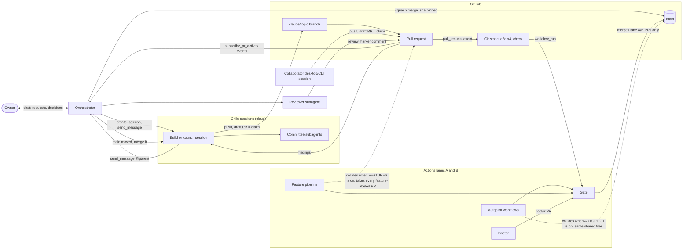
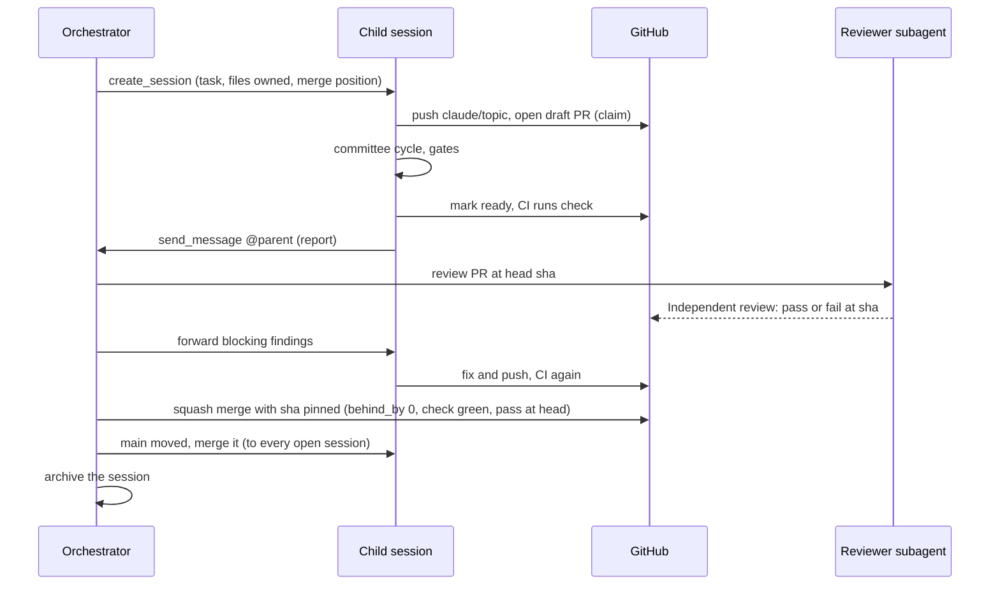

# Architecture of the development process

Who takes part in building Stock Social, how they talk to each other, and where each piece of state lives. What each
actor may decide is not here: it is in [decisions-and-authority.md → Who decides what](decisions-and-authority.md#who-decides-what).
Terms are defined in the [glossary](README.md#glossary).

## Actors

| Actor | Identity | Where it runs | Channels | Spec |
|---|---|---|---|---|
| **Owner** | The repo owner (the path owner in `.github/CODEOWNERS`) | Claude chat, desktop or CLI; GitHub | Talks to the orchestrator; on GitHub: merges, `/choose`, approvals, repo variables | [docs/POLICY.md](../POLICY.md) → H; [docs/AUTOPILOT.md](../AUTOPILOT.md) → What stays human |
| **Owner's own session** | A Claude session the owner drives directly, not started by the orchestrator (for example a design session) | Desktop, CLI or chat | Owner in the chat; the repo and GitHub | [docs/FEATURES.md](../FEATURES.md) → How Claude runs a design session |
| **Orchestrator** | The owner's orchestrating Claude session; one at a time, the orchestrator of record in [coordination.md](coordination.md) | Claude chat with the remote-session tools | All channels below | This folder |
| **Child session** | A cloud Claude Code session the orchestrator started for one work item: a feature build, cross-cutting build, fix or council | Claude Code cloud container | Its `create_session` prompt; `send_message` to `@parent`; its own branch and PR | [lifecycle.md](lifecycle.md); [collaboration.md](collaboration.md) |
| **Collaborator's desktop/CLI session** | A Claude client on someone's own computer, started outside the orchestrator | That computer | GitHub (draft-PR claim, PR comments) and the repo ([coordination.md](coordination.md)) only | [collaboration.md → Claiming and releasing work](collaboration.md#claiming-and-releasing-work) |
| **In-session committee roles** | Fresh-context subagents inside a child session, one per role: UX lead, business lead, engineer, tester, reviewer (legal where relevant) | Inside the child session | Their parent session only | [team/ux-lead.md](../../team/ux-lead.md), [team/business-lead.md](../../team/business-lead.md), [team/engineer.md](../../team/engineer.md), [team/tester.md](../../team/tester.md), [team/reviewer.md](../../team/reviewer.md); lane-C differences in [lifecycle.md](lifecycle.md#stages) stage 7 |
| **Councils run as sessions** | Child sessions whose output is a record, not code: idea board, direction councils (market research, creative, design), approval council, business, design system, game design | Claude Code cloud container | Like any child; the record goes to `docs/ideas/` or `docs/direction/` in its PR | [team/idea-board.md](../../team/idea-board.md), [team/direction-councils.md](../../team/direction-councils.md), [team/approval-council.md](../../team/approval-council.md) |
| **Orchestrator's reviewer subagent** | The independent review: one fresh-context subagent per PR, started by the orchestrator before it merges; sometimes a focused re-review of a fix round | Inside the orchestrator | Reads the PR; its verdict goes on the PR as a review marker | [team/reviewer.md](../../team/reviewer.md); [quality.md → Review standards](quality.md#review-standards) |
| **CI** | `.github/workflows/ci.yml`: jobs `static`, `e2e` (four shards), aggregate `check`, and `notify-gate` (only for runs the loop dispatched) | GitHub Actions | Runs on every `pull_request`, on `push` to `main` and on `workflow_dispatch`; results are check-runs on the head SHA | [quality.md → CI layout](quality.md#ci-layout) |
| **Lane A: Actions autopilot** | `build.yml`, `plan.yml`, `review.yml`, `gate.yml`, `choose.yml`, `judge.yml`, `queue.yml`, `doctor.yml`, driven by `scripts/autopilot.ts` | GitHub Actions; agents run in a job with no write token, and a separate `publish` job pushes ([docs/AUTOPILOT.md](../AUTOPILOT.md) → Security) | Issues, PRs, labels, comments, `docs/DECISIONS.md` | [docs/AUTOPILOT.md](../AUTOPILOT.md); [team/README.md](../../team/README.md) |
| **Lane B: Actions feature pipeline** | `features.yml` (jobs `pick`, `prepare`, `build`, `publish`), driven by `scripts/features.ts` and `scripts/team.ts` | GitHub Actions | Feature files, `feature/<id>` PRs, coordination briefs and hand-off notes | [docs/FEATURES.md](../FEATURES.md) → The pipeline (CI); [docs/IMPLEMENTATION.md](../IMPLEMENTATION.md) |
| **The Gate** | `gate.yml`, always running main's copy of `scripts/autopilot.ts gate` | GitHub Actions, after every CI or Review run | Merges or labels lane-A and lane-B PRs. For a lane-C PR it logs "not an open autopilot or feature PR" and does nothing (`scripts/autopilot.ts`, gate) | [docs/AUTOPILOT.md](../AUTOPILOT.md) → The loop |
| **The Doctor** | `doctor.yml` at minute 11 of every hour, `scripts/doctor.ts`; runs only when `AUTOPILOT=on` and `AUTOPILOT_MODE=lines` (`doctor.yml` job condition) | GitHub Actions | A PR into main from `autopilot/doctor-*` labeled `doctor`, merged by the Gate; or a note on the line issue when a human is needed | [team/doctor.md](../../team/doctor.md); [docs/AUTOPILOT.md](../AUTOPILOT.md) → Doctor: the loop fixes itself |

The orchestrator's duties, as activities (orchestrator report, 2026-11-01):
- start child sessions with a full prompt (`create_session`) and message them (`send_message`);
- check them (`list_sessions`, `get_session`: status, usage and `rate_limit_info`);
- subscribe to each PR's GitHub events (`subscribe_pr_activity`);
- run one independent reviewer subagent per PR before merging, and forward findings to the session;
- merge through the GitHub API (squash), one PR at a time;
- archive a session once its work is complete;
- keep one scheduled check-in every 30 minutes that re-runs these duties.

## Diagram

Lane C in the middle; lanes A and B share GitHub, CI and the Gate with it.

One lane-C PR, start to merge:

## Channels

| Channel | From → to | Carries | Notes |
|---|---|---|---|
| `create_session` prompt | Orchestrator → child | The task, files owned, merge position, depends-on | Sets the task's scope ([decisions-and-authority.md → Trust and relayed decisions](decisions-and-authority.md#trust-and-relayed-decisions)) |
| `send_message` | Child → `@parent`; orchestrator → child | Reports, findings, "main moved to `<sha>`, merge it" | Report template in [collaboration.md → Messaging](collaboration.md#messaging) |
| PR comments | Any client → PR | Review markers, findings, disputes | Marker format in [quality.md → Review standards](quality.md#review-standards) |
| Draft PR | Client → everyone | The claim on a work item | [collaboration.md → Claiming and releasing work](collaboration.md#claiming-and-releasing-work) |
| [coordination.md](coordination.md) | Each client edits its own row, in its own PR; the orchestrator reconciles | File ownership, merge order, depends-on, pre-PR plans | GitHub's state beats the table ([coordination.md](coordination.md) → Update rule) |
| PR-body hand-off notes | Builder → next builder | What a later builder must know | Format in [docs/FEATURES.md](../FEATURES.md) → How builders coordinate |
| GitHub PR events | GitHub → the one subscribed session | Comments, reviews, CI results | Only one session receives a PR's events at a time |

Etiquette for all channels: [collaboration.md → Messaging](collaboration.md#messaging).

## State and where it lives

| Where | What | Who can read it |
|---|---|---|
| Repo (main and branches) | Rules and these docs; feature files; records under `docs/features/logs/`, `docs/ideas/`, `docs/direction/`; [coordination.md](coordination.md) rows | Every client |
| GitHub | Branches; PRs (draft or ready), labels, PR bodies (claims, hand-off notes); comments (review markers); check-runs; merge commits; repo variables (`AUTOPILOT`, `FEATURES`) | Every client, except the variables: their values are inferred from heartbeat runs ([collaboration.md → Tool recipes](collaboration.md#tool-recipes)) |
| Orchestrator only (private) | Session ids, the queue file, usage snapshots, the scheduled check-in | The orchestrator and the owner; a new client asks them (FACTS "Private", orchestrator report 2026-11-01) |

Rule: anything another client needs must be on GitHub or in the repo, never only in a session (owner's request,
2026-11-01: the process "should be in github so multiple claude clients can collaborate and develop
simultaneously"). Session ids, queue contents and usage snapshots never go into the repo
([docs/POLICY.md](../POLICY.md) P1, P5).

## Concurrency

| Count | Scope | Time (UTC) | Source |
|---|---|---|---|
| About 24 sessions at once | All child sessions (builds and councils) | Peak on 2026-11-01 | Orchestrator report, counted with `list_sessions` |
| Thirteen sessions at once | Build and council sessions in the coordination map | Written 2026-11-01 07:36 (commit `9c20e63`) | [coordination log](../features/logs/coordination-2026-11-01.md) |

Open PRs and running items now: [coordination.md](coordination.md). Session kinds:
[lifecycle.md → Work-item kinds](lifecycle.md#work-item-kinds). Spend and throughput at this
concurrency: [budget-and-rate.md](budget-and-rate.md).

## Taking over as orchestrator

Use this when the orchestrator of record must be replaced: its session ended, it lost its context, or the owner moves
the role to another session. Start only when the owner asks you to take over, or the old orchestrator hands over in
writing; a peer's message alone is not enough
([decisions-and-authority.md → Trust and relayed decisions](decisions-and-authority.md#trust-and-relayed-decisions)).
This runbook's first written home is here (owner request 2026-11-01); the PR that added it asks the owner to protect
`/docs/process/` (open question Q7).

1. **Declare.** The old orchestrator stops merging first. Then open a PR that sets "Orchestrator of record" in
   [coordination.md](coordination.md) to your client kind and the UTC time. Never two orchestrators merging.
2. **Map sessions.** `list_sessions`, then `get_session` for each running child: match each to its branch and PR.
   Keep the ids private (they never go into the repo).
3. **Subscribe.** `subscribe_pr_activity` for every open PR. Only one session receives a PR's events: if another
   session still holds one, it must unsubscribe or end first.
4. **Check-in.** `list_triggers`: disable the old orchestrator's scheduled check-in (`update_trigger`, `enabled:
   false`), then create one of your own every 30 minutes. Never two.
5. **Reviews.** Re-read every `Independent review: … at <sha>` marker on open PRs. If a PR's head moved since its
   marker, review it again ([quality.md → Review standards](quality.md#review-standards)).
6. **Queue.** Rebuild the queue from the [coordination.md](coordination.md) rows in State `planned` and
   `queued-budget` ([lifecycle.md → States](lifecycle.md#states)).
7. **Budget.** Re-read `rate_limit_info.resetsAt` (`get_session`) and recompute admission
   ([budget-and-rate.md → Admission procedure](budget-and-rate.md#admission-procedure)).
8. **Switches.** Check `AUTOPILOT` and `FEATURES` state ([collaboration.md → Tool recipes](collaboration.md#tool-recipes)).
   If either is on, start no new work and tell the owner
   ([collaboration.md → When FEATURES or AUTOPILOT is on](collaboration.md#when-features-or-autopilot-is-on)).

Then send every running child one `send_message` naming the new orchestrator of record, and resume the duties in
[Actors](#actors).

## Known limits

- One orchestrator is a single point of failure for merges and reviews — a second, read-only standby that runs this
  runbook on a missed check-in would remove it.
- Session ids, the queue and usage snapshots are private to the orchestrator, so a takeover rebuilds them from GitHub
  and the repo — a repo-side queue file without ids or usage would remove the rebuild.
- Children cannot see each other except through GitHub and the repo — a shared channel readable by every session
  would remove it.
- Only one session holds a PR's event subscription, so a takeover must wait for the old holder to unsubscribe or
  end — a subscription that can be transferred would remove it.
- A cloud child's `@parent` is the session that created it, and cloud children cannot receive replies from peers;
  after a takeover, their reports still go to the old session — re-parenting in the session tools, or reports also
  posted as PR comments, would remove it.
- The Gate ignores lane-C PRs, so nothing automated enforces lane C's merge preconditions — a lane-C branch in the
  Gate's conditions (owner change to `scripts/autopilot.ts`) would remove it.
