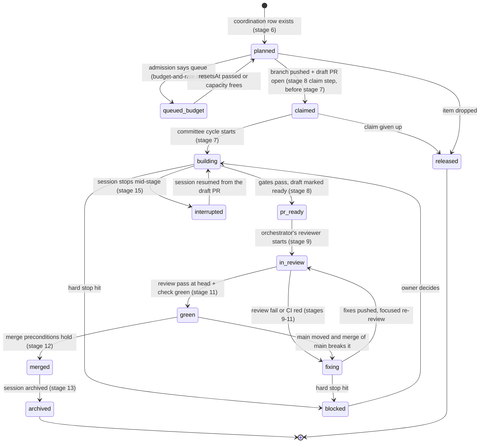

# Lifecycle of a work item

How one work item moves from an idea to an archived session in lane C (the interactive orchestrator; lanes and
terms: [README → The three lanes](README.md#the-three-lanes), [README → Glossary](README.md#glossary)). Each stage
names who acts, what goes in and out, and when the stage is done. Who may decide what is in
[decisions-and-authority.md → Who decides what](decisions-and-authority.md#who-decides-what); this file only names
the actor.

Two words are kept apart on purpose: a work item has a **State** (below, [States](#states)); a feature file has a
**Status** (`draft`, `ready`, `built`, `accepted`, `rework`, `blocked`; defined in
[docs/FEATURES.md → Feature files](../FEATURES.md)). They never mix.

## Overview

`queued_budget` and `pr_ready` are written `queued-budget` and `pr-ready` everywhere else (Mermaid state ids
cannot hold a hyphen). Order in time: stage 6 (row, session) → the claim step of stage 8 (branch, draft PR, claim
notice) → stage 7 (committee) → the ready step of stage 8 → stage 9. Stage 8 is listed after 7 because the PR is
finished there.

## Work-item kinds

| Kind | Stages it passes | One PR or three variants |
|---|---|---|
| Feature build | 5–14 (1–4 already passed by the approval council or a design session) | One PR per session in practice. **Pending owner: CLAUDE.md "Three versions per product change" asks for three variants for any product change; lane C builds one. Open question Q1** ([decisions-and-authority.md → Open questions](decisions-and-authority.md#open-questions-for-the-owner)) |
| Cross-cutting build (privacy, security, sync, CI speed, a known-limits sweep …) | 6–14 (stage 7 as in [Cross-cutting build without a feature file](#cross-cutting-build-without-a-feature-file)) | One PR. **Pending owner, CLAUDE.md three-versions rule, Q1** (for the parts that change the product) |
| Fix | 6, 8–13 | One PR. Exempt from the three-versions rule by the rule's own text ("not fixes, tests or chores", CLAUDE.md) |
| Dependency bump | 8–13 | One PR, opened by the code host's dependency bot (#26, #27, #28 on 2026-11-01). A bump of an installed package is not a *new* dependency; adding one is owner-only (POLICY H). Who reviews bumps: orchestrator report, 2026-11-01, not recorded in the repo |
| Council or record (idea board, direction councils, approval council, business) | 6, 8–13 (the council's own rounds replace stage 7) | One PR |
| Docs | 6, 8–13 | One PR |

Where each kind files its log or record: [decisions-and-authority.md → Records](decisions-and-authority.md#records).

### Cross-cutting build without a feature file

Current practice (orchestrator report, 2026-11-01), not an owner rule. [IMPLEMENTATION.md → The cycle](../IMPLEMENTATION.md#the-cycle-draft)
starts from a feature file and its acceptance criteria. A cross-cutting build has neither, so stage 7 differs:
- The **plan debate runs on the brief**: the task prompt and the coordination row. The plan it signs states the
  checks that stand in for acceptance criteria (for a sweep: each note resolved or rewritten as
  `<limit> — <fix>`, and a test for each behavior change). Tests first still applies to those checks.
- **User tests** (The cycle, step 4) run only when the change alters what a user sees.
- Everything else in stage 7 applies, including the in-session review and the verdict step. The record goes to
  `docs/features/logs/<topic>/`.

## Stages

Each stage: **Who acts · Input · Output · Exit criterion · Source.**

### 1. Idea
- **Who:** anyone (owner, design session, committee, agent).
- **Input:** a one-line idea. **Output:** a register row with status `proposed`.
- **Exit:** the row exists in `docs/IDEAS.md` → Register.
- **Source:** [docs/IDEAS.md → How an idea gets reviewed](../IDEAS.md) step 1. Who writes the register in practice
  is open question Q2.

### 2. Idea board
- **Who:** the idea board (fresh-context agents, no one reviews their own idea).
- **Input:** `proposed` rows. **Output:** `docs/ideas/<date>-<topic>.md`; register status `adopted`, `adopted with
  conditions`, `testing` or `rejected`.
- **Exit:** the review is filed and the register updated; where the owner delegated, the board's recommended option is
  recorded as the decision.
- **Source:** [team/idea-board.md](../../team/idea-board.md) "The process" and "What happens to the result".

### 3. Direction councils
- **Who:** market research, creative direction and design direction councils, each run as its own session.
- **Input:** the product and the register. **Output:** a record in `docs/direction/` plus proposals, which go to the
  register and then through stage 2.
- **Exit:** the record is merged and its proposals are in the register.
- **Source:** [team/direction-councils.md](../../team/direction-councils.md) "What happens to proposals".

### 4. Approval council
- **Who:** the approval council.
- **Input:** adopted ideas. **Output:** votes in `docs/ideas/approval-<date>.md`; approved items written in the
  feature-file shape.
- **Exit:** approved under [team/approval-council.md](../../team/approval-council.md) → Approval rule. The numbers
  (voters, rounds, thresholds, per-cycle cap) live only there.
- **Source:** team/approval-council.md; owner delegation 2026-11-01 (POLICY H, second paragraph).

### 5. Feature file
- **Who:** the orchestrator numbers it; nobody else assigns `F-<n>` (team/direction-councils.md "What happens to
  proposals": "numbered by the orchestrator, never by a council, so parallel councils do not collide").
- **Input:** an approved item, or a design-session decision. **Output:** `docs/features/F-<n>-<slug>.md` with
  `Status: ready`.
- **Exit:** the file is on main with `Status: ready`. Status meanings and who sets them: docs/FEATURES.md.
- A desktop or CLI client working without an orchestrator never assigns a number; it uses the placeholder
  `F-?-<slug>` in its PR and asks the owner (collaboration.md
  [Claiming and releasing work](collaboration.md#claiming-and-releasing-work)).

### 6. Build session start
- **Who:** the orchestrator.
- **Input:** a `ready` feature file or a cross-cutting topic. **Output:** a row in
  [coordination.md → Work items](coordination.md#work-items) with the exact branch name, files owned, merge position
  and depends-on; then a session started with `create_session` and a full prompt that names the row and the branch.
- **Check GitHub first:** right before `create_session`, the orchestrator re-runs the Open PRs and Unregistered
  branches recipes ([collaboration.md → Tool recipes](collaboration.md#tool-recipes)) and skips an item that a draft
  PR or a pushed branch already claims (process-docs lead, usability pass 5, 2026-11-01).
- **Exit:** the row exists **before** `create_session` (team/approval-council.md "After approval"; coordination log
  2026-11-01: approved features "join this map with their owned files and merge position before their build session
  starts"). Admission against the usage window is checked first
  ([budget-and-rate.md → Admission procedure](budget-and-rate.md#admission-procedure)); if it says queue, the State is
  `queued-budget`.
- **Folding:** the orchestrator may fold an item into a running session that owns the same files instead of starting
  a new one (team/approval-council.md "After approval"). Examples on 2026-11-01 (orchestrator report): F-10 with F-12,
  F-13 with accessibility fixes, F-14 inside sharded sync.

### 7. Committee cycle
Runs [docs/IMPLEMENTATION.md → The cycle](../IMPLEMENTATION.md) and its Decisions. Those steps are not restated
here. **Lane-C differences only:**
- The build committee's roles run as fresh-context subagents inside the build session (UX lead, business lead,
  engineer, tester; specs in `team/`), not through `scripts/team.ts`.
- Legal joins the plan debate where the item touches POLICY or COMPLIANCE (orchestrator report, 2026-11-01).
- Open questions found during the cycle are handled under the owner's delegation of 2026-11-01 ("open questions
  decided by the committee's recommended option and recorded"; text and scope in
  [decisions-and-authority.md → Delegations and process decisions by the owner](decisions-and-authority.md#delegations-and-process-decisions-by-the-owner)). How
  far it reaches against IMPLEMENTATION.md Hard stops and its 2026-10-22 "the feature waits" decision is open question
  Q3; until the owner answers, both texts stand as written.
- An in-session review (a fresh-context reviewer subagent, `team/reviewer.md`) runs after the committee and before
  the PR, and every verified blocking finding is fixed before stage 8 (example:
  `docs/features/logs/F-6/review.md`, verdict "not approved (2 BLOCKING …)", then fixed).
- The branch is the session's own `claude/<topic>`, not the lane-B branch named in The cycle
  ([collaboration.md → Branches](collaboration.md#branches)).
- The cycle ends in a PR the orchestrator merges, not "Gate merges → Status: built" (stages 12 and 14).
- Without a feature file: [Cross-cutting build without a feature file](#cross-cutting-build-without-a-feature-file).

**Committee verdict step: kept.** Checked 2026-11-01 in the lane-C logs: each records a compliance verdict and a
usability verdict per committee member, and a re-sit until both pass (`docs/features/logs/F-6/committee-ux-lead.md`
"Round 2 verdict: compliance PASS, usability PASS"; `F-6/committee-business-lead.md`; `F-3/committee-review-ux-lead.md`
and `committee-review-business-lead.md` "COMPLIANCE: PASS"). One gap: `privacy/committee-2026-11-01.md` records
round-2 usability FAIL verdicts, then "All fixed as below", with no recorded re-sit that passes. A build that skips
the verdict step, or ends without a passing re-sit, does not meet this stage.

### 8. Pull request
- **Who:** the build session.
- **Input:** the session's branch. **Output:** one PR per session into `main`, label `feature`. The label collides
  with lane B when `FEATURES` is on ([collaboration.md → When FEATURES or AUTOPILOT is on](collaboration.md#when-features-or-autopilot-is-on));
  not every lane-C PR carries it (current labels: [coordination.md](coordination.md#work-items)); label policy is
  open question Q4.
- **Claim step (before stage 7): open it early as a draft; the draft PR is the claim**, followed by the claim
  notice ([collaboration.md → Claiming and releasing work](collaboration.md#claiming-and-releasing-work)). Write
  recipes: [collaboration.md → Tool recipes](collaboration.md#tool-recipes).
  The Gate ignores draft PRs (`scripts/autopilot.ts` gate: `pr.isDraft` → "not an open autopilot or feature PR").
- **Body:** `## Compliance` (COMPLIANCE §1 answers; [quality.md → Compliance](quality.md#compliance)),
  `## Known limits` ([quality.md → Ponytail convention](quality.md#ponytail-convention)), `## Hand-off notes`
  (format: docs/FEATURES.md "How builders coordinate").
- **Exit (draft → ready, State `pr-ready`):** every gate in [quality.md → Before every push](quality.md#before-every-push)
  passed on the head, the committee passed, the in-session review's blocking findings are fixed, and the session has
  sent the full report: to `@parent`, or, for a client without session tools, as a comment on the PR
  ([collaboration.md → Messaging](collaboration.md#messaging)).

### 9. Independent review
- **Who:** the orchestrator runs one fresh-context reviewer subagent per PR (sometimes a focused re-review of a fix
  round).
- **Input:** the PR at a head SHA. **Output:** a review marker comment (`pass` or `fail` at that SHA) and the blocking
  findings ([quality.md → Review standards](quality.md#review-standards), the single home of the marker format and of
  "verified" and "blocking").
- **Exit:** a `pass` marker at the current head, or findings forwarded to the session (State `fixing`).
- **Never by the author's own context.** The independent review is never run in the context that built the change.
- **Without an orchestrator:** the client starts a fresh-context reviewer subagent per `team/reviewer.md`; it posts
  the marker, and the orchestrator (when it next runs) or the owner merges. Collaborators never merge (process-docs
  lead, usability pass 5, 2026-11-01). When markers from that subagent and from the orchestrator's or owner's
  reviewer exist at the same head, the orchestrator's or owner's marker counts.

### 10. Fix rounds
- **Who:** the build session.
- **Exit:** every verified blocking finding is fixed and pushed; the reviewer re-reviews the new head. A finding the
  builder disputes goes back to the reviewer; the builder never closes a finding alone
  ([quality.md → Review standards](quality.md#review-standards)).

### 11. CI
- **Who:** GitHub Actions (`.github/workflows/ci.yml`).
- **Exit:** job `check` is `success` on the head SHA ([quality.md → CI layout](quality.md#ci-layout)).

### 12. Merge
- **Who:** the orchestrator (squash, via the GitHub API). Sessions never merge.
- **Exit criterion, all of:**
  - `behind_by == 0` against main (REST `compare/main...<head>`);
  - `check` green on that exact head;
  - `Independent review: pass at <head sha>` posted for that head;
  - the PR's merge position in [coordination.md → Merge order (current)](coordination.md#merge-order-current) is
    reached, or it may go early under [collaboration.md → Merge order](collaboration.md#merge-order); a PR with no
    position merges when the orchestrator or the owner gives it one;
  - merged one PR at a time ([collaboration.md → Merge order](collaboration.md#merge-order));
  - squash merge with `sha` set to the reviewed head (the merge API's `sha` field), so a push after the review
    cannot slip in.
- **After the merge:** the orchestrator checks `check` on main's new commit. If it is red: stop merges, open a fix
  item at merge position 1, and tell sessions not to merge main until it is green. Otherwise it sends every open
  session "main moved to `<sha>`, merge it" (collaboration.md [Messaging](collaboration.md#messaging)). After a merge
  the orchestrator did not make (for example the owner's), it sends the same message at its next check-in. Clients
  without session tools check main's head themselves before each push (recipe "Main's head" in
  [collaboration.md → Tool recipes](collaboration.md#tool-recipes)).
- Whether the orchestrator may merge a PR that touches a CODEOWNERS path is open question Q6 (the practice so far
  is recorded there).

### 13. Archive
- **Who:** the orchestrator.
- **Exit:** the session is archived as soon as its work is complete: its PR merged, or its record delivered and
  checked with nothing left for it (owner, 2026-11-01; coordination log "Closing finished work", unchanged there).

### 14. After merge: feature Status
- docs/FEATURES.md has lane B's publish step set `Status: built` in the feature's PR. Lane C has no such step, so
  features merged in lane C keep `ready` or `rework` (current list:
  [coordination.md → Feature files after lane-C merges](coordination.md#feature-files-after-lane-c-merges)).
- Consequence: with `FEATURES=on`, lane B would pick these features up again and rebuild them.
- Who sets `built` in lane C is open question Q8. This file never edits a feature file.

### 15. Interrupted work
- A session that must stop mid-stage pushes its work in progress to its own branch, keeps the draft PR, and writes in
  the PR body the stage reached and the next step, then reports to `@parent`.
- A resumed session (or a replacement) reads the PR body and the item's log directory and continues on the same
  branch. Never open a second branch or PR for the same item.

## States

| State | Entry criterion | Exit criterion | Stages |
|---|---|---|---|
| `planned` | A coordination row exists with files owned, merge position and depends-on | A session claims it (`claimed`), the admission check queues it (`queued-budget`), or it is dropped (`released`) | 5–6 |
| `queued-budget` | Admission says the work clearly exceeds the window ([budget-and-rate.md](budget-and-rate.md#admission-procedure)) | `rate_limit_info.resetsAt` has passed or capacity frees → `planned` | 6 |
| `claimed` | Branch `claude/<topic>` pushed and a draft PR open with the claim line | The committee cycle starts → `building` | 8 (claim step, after 6 and before 7) |
| `building` | Committee cycle running on the branch | Gates pass and the draft is marked ready → `pr-ready` | 7 |
| `pr-ready` | Draft PR marked ready for review, report sent | The orchestrator's reviewer starts → `in-review` | 8 |
| `in-review` | A reviewer subagent is reviewing a named head | `pass` marker at head and `check` green → `green`; `fail` or red CI → `fixing` | 9, 11 |
| `fixing` | Blocking findings or red CI on the head | Fixes pushed → `in-review` | 10–11 |
| `green` | `pass` marker and `check` green on the same head | Merge preconditions hold → `merged`; main moved and the merged result fails → `fixing` | 11–12 |
| `merged` | Squash merge on main | Session archived → `archived` | 12 |
| `archived` | Session archived | none (final) | 13 |
| `blocked` | A hard stop is hit ([Hard stops](#hard-stops)) | The owner decides → back to the State it left | any |
| `interrupted` | The session stopped mid-stage, work pushed, draft PR records the next step | A session resumes on the same branch → `building` (or the State recorded) | 15 |
| `released` | Claim given up or item dropped: draft PR closed, row set to `released` with the reason | none (final) | any |

These names are the only State words. coordination.md's State column uses them.

## Hard stops

The hard stops are [docs/IMPLEMENTATION.md → Hard stops](../IMPLEMENTATION.md) and POLICY H ("Human-only decisions").
Lane C adds two, owned elsewhere:
- the usage budget reaches "rejected"/overage: no new work is admitted
  ([budget-and-rate.md → Rules](budget-and-rate.md#rules-owner-2026-11-01));
- a change to a protected path needs the owner
  ([decisions-and-authority.md → Owner-only](decisions-and-authority.md#owner-only); mechanics in
  [quality.md → Protected paths (mechanics)](quality.md#protected-paths-mechanics)).

A session at a hard stop sets its row to `blocked`, says what the owner should do, and stops
([decisions-and-authority.md → Escalation](decisions-and-authority.md#escalation)).

## Known limits

- Lane C builds one PR per product change where CLAUDE.md asks for three variants — the owner answers Q1.
- The cross-cutting variant of stage 7 is current practice reported by the orchestrator, not an owner rule — the
  owner confirming it (or IMPLEMENTATION.md → The cycle naming it) removes this.
- No lane-C step sets a feature file's `Status: built`, so lane B would rebuild merged features when switched on — the
  owner answers Q8, or a publish step for lane C is added.
- The review marker of stage 9 was defined on 2026-11-01; before it, review findings went to sessions by message, so
  earlier reviews left no record on their PRs — reviews posting the marker from now on removes this.
- Stages 1–4 depend on the register's writer, which three texts describe differently — the owner answers Q2.
- The privacy build (#31) merged with no recorded passing committee re-sit after its round-2 FAIL verdicts — a re-sit
  record per committee round removes this.
- Reviews of dependency bumps are not recorded in the repo — a line in the merge report or the PR removes this.
- The State of an item lives in coordination.md and on GitHub, and only the orchestrator reconciles them — a script
  that derives State from GitHub (REST only) removes this.
